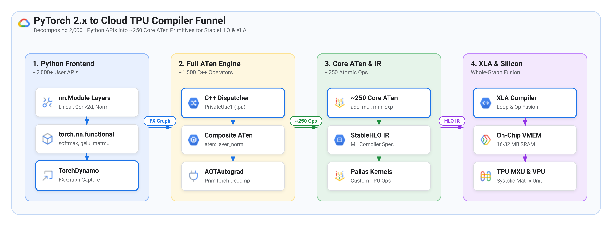
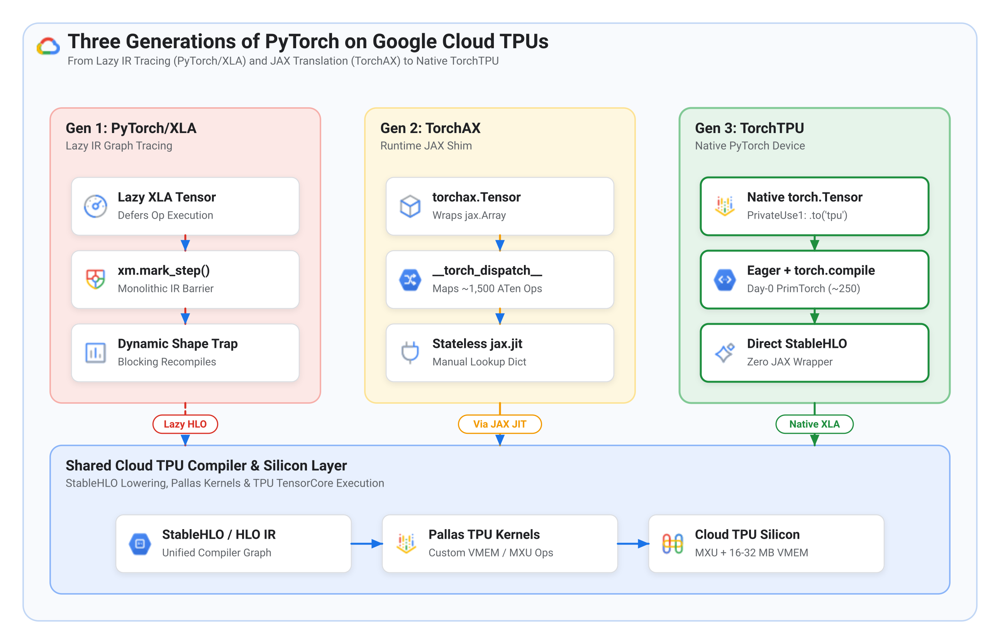

# The evolution of PyTorch on Cloud TPUs: From JAX and PyTorch/XLA to TorchAX and native TorchTPU

> **Author:** [Bharath Rathinam](https://github.com/engineerbharath12) · **Track:** [Accelerator Diversity Series](../) (Part 1 of 2)  
> **Companion Guide:** [Part 2 — Bridging hardware NVDEC with split CPU-TPU decoding and a common codebase](../02-torchtpu-video-preprocessing-accelerator-diversity/)

While over 90% of open-weight foundation models and enterprise AI pipelines are authored in stateful, eager-first PyTorch, Google Cloud Tensor Processing Units (**TPUs**) were designed from the ground up around whole-graph compilation (**XLA**) and functional array programming (**JAX**). This guide traces the architectural evolution of running PyTorch workloads on Cloud TPUs—from early lazy-graph tracers and runtime JAX translation shims to the native **TorchTPU** (`torch_tpu`) backend—showing how TorchTPU delivers native PyTorch ergonomics without sacrificing compiler performance. First, we break down the PyTorch 2.x operator funnel (Python API → ATen → Core ATen primitives → StableHLO → XLA) and examine why earlier bridges struggled with dynamic shapes and operator coverage. Second, we analyze how TorchTPU unifies native PyTorch C++ dispatch with XLA whole-graph fusion and define the practical boundary between automatic Day-0 operator support and hardware-specific dependencies.

---

## Section 1: Understanding the compiler bridge between PyTorch and TPU silicon

To understand why running PyTorch on a Cloud TPU required multiple architectural generations, you first need to compare how GPUs and TPUs execute math at the silicon level.

### How GPU kernel dispatch differs from TPU whole-graph compilation

In standard PyTorch on a GPU, execution is **eager and imperative**. When a Python script executes a line such as `y = torch.matmul(a, b)`, Python delegates to PyTorch's C++ engine, which pushes an individual CUDA kernel onto an asynchronous hardware stream. Each CUDA kernel reads its inputs from off-chip GPU High-Bandwidth Memory (**HBM** / VRAM), computes inside Streaming Multiprocessor (**SM**) registers and a small 128–228 KB Shared Memory (**SRAM**) tile, and writes its output back to HBM before the next Python line launches.

A Google Cloud TPU (such as **Cloud TPU v6e Trillium** or **TPU v7 Ironwood**) operates on a fundamentally different hardware philosophy:

1. **Massive systolic matrix units and multi-megabyte on-chip SRAM**: Each TPU TensorCore pairs 256×256 Matrix Multiply Units (**MXU**) and a Vector Processing Unit (**VPU**) with **16–32 MB of contiguous on-chip Vector Memory (VMEM SRAM)**—roughly 100× larger on-chip SRAM per core than a single GPU SM.
2. **Whole-graph XLA operator fusion**: Rather than launching tiny kernels one operation at a time and round-tripping intermediate tensors to off-chip HBM, the **Accelerated Linear Algebra (XLA)** compiler ingests an entire computation graph ahead of execution. XLA solves a static 2D tiling and memory-allocation schedule, fusing chains of matrix multiplications, rescalings, and activations into a single hardware loop where intermediate tensors stay 100% resident inside on-chip VMEM.

### Why JAX was originally the native language of Cloud TPUs

Because XLA requires a clean, side-effect-free computation graph to fuse operations across VMEM and the MXU, **JAX** emerged as the natural programming model for TPUs:

* **Purely functional and stateless**: In JAX, functions take immutable arrays as inputs and return new arrays as outputs without mutating object attributes in place.
* **Deterministic JIT capture**: When a developer decorates a function with `@jax.jit`, JAX traces the function once with abstract shapes, lowers the trace into **StableHLO** (Stable High-Level Operations, an open intermediate representation for ML compilers), and hands the StableHLO module to XLA.
* **Custom Pallas kernels**: For irregular or long-context operations where compiler auto-fusion is insufficient (such as paged KV-cache attention or ragged Mixture-of-Experts routing), engineers write hardware-aware kernels in **Pallas** (JAX's kernel language for TPU VMEM and SparseCore DMA pipelining).

However, the broader AI ecosystem standardized around **PyTorch**, which is inherently **stateful and object-oriented**. In PyTorch, models are stateful `nn.Module` classes that hold mutable parameter buffers (`self.weight`) and frequently mutate tensors in place (such as updating KV-cache slices or indexing dynamic bounding boxes). Bridging stateful PyTorch to stateless XLA required rethinking how PyTorch unpacks operations under the hood.

### Deconstructing the PyTorch operator funnel: From 2,000 Python APIs to 250 Core ATen primitives

When a developer writes high-level PyTorch code, that call passes through a 4-layer software funnel before reaching physical silicon.

---

### Figure 1: The PyTorch 2.x operator funnel from 2,000+ Python APIs to 250 Core ATen primitives and StableHLO



*Credit & Source: System architecture synthesis based on PyTorch 2.x (`PrimTorch` / `AOTAutograd`) and Google Cloud TorchTPU compiler pipelines.*

---

Each layer in Figure 1 reduces operator complexity by an order of magnitude:

1. **Layer 1 — PyTorch Python frontend (~2,000+ APIs)**: User-facing classes and functions developers write daily, such as `torch.nn.Linear`, `F.layer_norm`, and `F.softmax`, which handle Python argument parsing, broadcasting rules, and object state.
2. **Layer 2 — Full ATen C++ engine (~1,500 operators)**: Python delegates every frontend call to **ATen** ("A Tensor Library"), PyTorch's core C++ math library containing over 1,500 operators, including composite ops (`aten::layer_norm`, `aten::addmm`) and in-place variants (`aten::add_`).
3. **Layer 3 — PrimTorch Core ATen subset (~250 atomic primitives)**: Prior to PyTorch 2.0, any hardware vendor building a custom accelerator backend had to implement C++ kernels for over 1,500 separate ATen operators. In PyTorch 2.0, **PrimTorch** (inside `AOTAutograd`) proved that ~1,250 composite ATen operators decompose mathematically into a closed set of **~250 irreducible Core ATen primitives** (`add`, `mul`, `mm`, `amax`, `exp`, `sum`, `div`, `reshape`).
4. **Layer 4 — StableHLO and XLA lowering**: Once a model graph is expressed in those ~250 Core ATen primitives, a compiler backend only needs a one-time lowering table into **StableHLO**, which **XLA** compiles into Low-Level Operations (**LLO**) for the TPU MXU and VPU.

To see this decomposition in action, consider a single Python call to `torch.softmax(x, dim=-1)`. When traced by `torch.compile`, PyTorch's `AOTAutograd` automatically expands that single call into 5 atomic Core ATen primitives:

```python
# User writes 1 high-level PyTorch call:
y = torch.softmax(x, dim=-1)

# AOTAutograd / PrimTorch decomposes it into 5 Core ATen primitives:
max_val = torch.ops.aten.amax.default(x, [-1], keepdim=True)  # 1. Row maximum
shifted = torch.ops.aten.sub.Tensor(x, max_val)                # 2. Subtract max
exps    = torch.ops.aten.exp.default(shifted)                  # 3. Exponentiate
sum_exp = torch.ops.aten.sum.dim_IntList(exps, [-1], True)     # 4. Row sum
y       = torch.ops.aten.div.Tensor(exps, sum_exp)             # 5. Normalize
```

> **Key Compiler Insight:** Because XLA receives all 5 Core ATen primitives inside a single StableHLO graph, the XLA compiler fuses them right back into a single pass over on-chip VMEM—never writing `max_val`, `shifted`, or `exps` out to off-chip HBM.

---

## Section 2: The three generations of running PyTorch on Cloud TPUs

Over the past several years, Google and the open-source PyTorch community (including maintainers of **vLLM** and **SGLang**, alongside ecosystem partners highlighted in SemiAnalysis's *InferenceX* architectural benchmark report) evolved PyTorch support on TPUs through three distinct stages.

---

### Figure 2: Architectural evolution of PyTorch on Cloud TPUs — PyTorch/XLA vs. TorchAX vs. native TorchTPU



*Credit & Source: Architectural synthesis adapted from SemiAnalysis ("TPU Inference Externalization Full Steam Ahead - InferenceX"), Google Cloud TPU Engineering, and PyTorch `PrivateUse1` documentation.*

---

### Generation 1: PyTorch/XLA and the "lazy evaluation" compilation trap

The first generation, **PyTorch/XLA**, predated PyTorch 2.0's `TorchDynamo` and PrimTorch compiler stack. Because PyTorch 1.x lacked a clean way to capture whole graphs from eager Python code, PyTorch/XLA introduced **Lazy Tensors** (`device="xla"`):

* **How it worked**: When Python code ran `c = a + b`, nothing executed immediately on the TPU. Instead, PyTorch/XLA recorded the operation into a background Intermediate Representation (**IR**) directed acyclic graph (**DAG**) until execution hit an explicit synchronization barrier (`xm.mark_step()` or `.cpu()`), at which point the accumulated DAG was sent to XLA for compilation.
* **Why it struggled in production**:
  1. **Dynamic shape recompilation stalls**: Whenever an input tensor shape changed (such as varying prompt lengths in LLM serving or varying object counts in vision pipelines), the lazy IR graph hash changed, triggering a blocking XLA recompilation that could stall execution for minutes.
  2. **Broken interactive debugging**: Because operations were recorded lazily rather than executed eagerly, placing a standard Python `print(tensor)` or `pdb` breakpoint in the middle of a model either forced a premature graph split or failed to reflect runtime state.

### Generation 2: TorchAX (`tpu-inference`) and the JAX translation middleman

When generative AI serving engines like **vLLM** and **SGLang** surged in adoption between 2023 and 2025, Google already possessed mature TPU inference primitives—such as TPU PagedAttention, multi-host ICI mesh collectives, and custom Pallas kernels—written in **JAX**. Meanwhile, PyTorch 2.0's out-of-tree C++ compiler extensions (`PrivateUse1` and dynamic-shape `TorchDynamo`) were still maturing.

To bring PyTorch models onto TPUs quickly while reusing mature JAX kernels, Google built **TorchAX** (used in vLLM's `tpu-inference` backend):

* **How it worked**:
  1. A `torchax.tensor.Tensor` looked like a PyTorch tensor to Python code, but wrapped an underlying `jax.Array`.
  2. Whenever a PyTorch model invoked an operation, TorchAX intercepted the call at the **high-level ~1,500 ATen operator layer** using Python's `__torch_dispatch__` mechanism *before* PrimTorch decomposition.
  3. TorchAX translated each intercepted ATen call into equivalent `jax.numpy` or `jax.lax` functions on the fly, while functionalizing stateful PyTorch `nn.Module` weights and KV caches into explicit stateless inputs so `@jax.jit` could compile the step.
* **Why TorchAX hit a scaling ceiling**:
  1. **The ~1,500-operator translation treadmill**: Because TorchAX intercepted operations at the un-decomposed ATen layer, engineers had to manually maintain a Python lookup dictionary mapping hundreds of ATen ops to JAX equivalents. Whenever a new Hugging Face model architecture used an unmapped ATen op or an in-place view mutation, execution failed until that translation rule was added manually.
  2. **Framework boundary friction**: Serving engines (vLLM, SGLang) had to bypass their native `torch.compile` pipelines and maintain custom JAX-wrapping shims (or, in the case of SGLang-JAX, an entirely separate JAX runtime) to bridge stateful PyTorch schedulers with stateless `jax.jit` execution.

### Generation 3: Native TorchTPU (`torch_tpu`) via PyTorch `PrivateUse1` and PrimTorch

Once PyTorch 2.4+ stabilized out-of-tree C++ device registration (`PrivateUse1`), automatic dynamic shapes, and PrimTorch decompositions, Google collaborated with the PyTorch, vLLM, and SGLang communities to build **TorchTPU** (`torch_tpu`)—moving the integration boundary directly into PyTorch's native C++ core:

* **Native `torch.Tensor` via `PrivateUse1` (`device="tpu"`)**: TorchTPU registers `tpu` as a first-class C++ device inside PyTorch's native dispatcher (`x = tensor.to("tpu")`). There is no `jax.Array` wrapper and no Python `__torch_dispatch__` translation shim.
* **True eager mode + `torch.compile(backend="tpu")`**: Developers can run standard PyTorch code line-by-line in eager mode (`PJRT_DEVICE=TPU`) for instant bring-up, `print()` inspection, and unit testing. For production throughput, wrapping the model or step function in `torch.compile(..., backend="tpu")` captures the graph via `TorchDynamo` and `AOTAutograd`, decomposes all high-level PyTorch operators down to the closed set of **~250 Core ATen primitives**, and lowers them directly into StableHLO and XLA.
* **Automatic Day-0 support for new PyTorch models**: Because PyTorch's own upstream PrimTorch engine decomposes any new composite PyTorch operator into the ~250 Core ATen primitives—and TorchTPU natively lowers those ~250 primitives to StableHLO—new PyTorch layers and model architectures work out of the box without manual JAX translation tables.
* **Direct Pallas kernel interop**: Removing the TorchAX translation layer does **not** mean losing hand-tuned TPU kernels. TorchTPU allows native PyTorch graphs to invoke custom **Pallas** and **SparseCore** kernels (such as SplashAttention, PagedAttention, and ragged GroupedGEMM MoE kernels) directly as custom ops inside the StableHLO graph.

The table below summarizes the architectural trade-offs across native JAX and the three generations of PyTorch on Cloud TPUs:

| Architectural dimension | Native JAX (`jax.jit`) | Gen 1: PyTorch/XLA (LazyTensor) | Gen 2: TorchAX (`tpu-inference`) | Gen 3: Native TorchTPU (`torch_tpu`) |
| :--- | :--- | :--- | :--- | :--- |
| **Underlying tensor object** | Stateless `jax.Array` | Lazy XLA IR wrapper tensor | `torchax.tensor.Tensor` wrapping `jax.Array` | **Native C++ `torch.Tensor` (`device="tpu"`)** |
| **Operator interception layer** | Native `jax.lax` primitives | C++ Lazy IR recorder (`xm.mark_step`) | Python `__torch_dispatch__` on ~1,500 ATen ops | **C++ `PrivateUse1` + ~250 Core ATen ops** |
| **Day-0 support for new PyTorch ops** | Manual rewrite in JAX | Partial (unlowered ops fall back to CPU) | Breaks if op is missing from JAX lookup dict | **Automatic via PrimTorch (~250 ops)** |
| **Line-by-line eager debugging** | Yes (before `@jax.jit`) | No (lazy graph delays execution) | Limited by JAX functionalization shims | **Full native PyTorch eager mode** |
| **Production compiler path** | `@jax.jit` → StableHLO → XLA | Monolithic lazy DAG → XLA | Bypasses `torch.compile`; uses `@jax.jit` | **`torch.compile(backend="tpu")` → StableHLO → XLA** |
| **Custom TPU kernels (Pallas)** | Native first-class | Limited C++ XLA custom calls | Supported via underlying JAX runtime | **Direct Pallas & SparseCore invocation** |

---

## Section 3: What TorchTPU solves automatically vs. what still requires engineering

Understanding the PrimTorch funnel in Figure 1 clarifies the exact engineering expectation when porting an existing GPU-first PyTorch workload to Cloud TPUs with TorchTPU.

### What works out of the box (90%–95% of a PyTorch codebase)

Any code built from standard PyTorch operations—convolutions, linear projections, normalization layers, activation functions, loss functions, tensor indexing, and standard attention math—decomposes automatically into the ~250 Core ATen primitives. Model definitions (`model.py`) and pre-trained weight checkpoints (`.safetensors` or `.pt`, which store raw floating-point arrays mapped to layer names) load directly onto `device="tpu"` with zero JAX rewrites.

### Where targeted hardware engineering is still required (the 5%–10% boundary)

> **Portability Rule of Thumb:** TorchTPU eliminates the *framework* translation tax across PyTorch and XLA, leaving only the 5%–10% of code that invokes compiled CUDA C++ extensions, dynamic unbucketed shapes, or fixed-function GPU silicon blocks.

Three specific scenarios cross that hardware boundary in production pipelines:

1. **Custom C++/CUDA extensions**: If a pipeline invokes a compiled C++/CUDA extension (such as `torchvision.ops.roi_align`, custom CUDA deformable convolutions, or inline Triton kernels), PrimTorch cannot decompose compiled CUDA C++ into Core ATen primitives. To run on TPU without falling back to the host CPU over PCIe, you either express that operator in standard PyTorch tensor operations (so `torch.compile(backend="tpu")` lowers and fuses it automatically into XLA) or invoke a TPU Pallas kernel.
2. **XLA static shape and VMEM fusion awareness**: Because XLA compiles static memory layouts for the TPU's MXU and 16–32 MB VMEM, workloads with highly variable batch sizes (such as dynamic object counts per frame) benefit from pre-warming a small ladder of **static batch buckets** (for example, `32, 64, 96, 128`) at startup to eliminate runtime recompilation.
3. **Fixed-function GPU hardware blocks (NVDEC media decoders)**: Modern GPUs (such as **Google Cloud G4** instances with **NVIDIA RTX PRO 6000 Blackwell** GPUs) include dedicated fixed-function silicon blocks (**NVDEC**) for hardware video bitstream decoding via TorchCodec or FFmpeg. Cloud TPUs dedicate 100% of their die area to matrix (MXU), vector (VPU), and sparse (SparseCore) compute, meaning they contain **zero hardware video decode engines (0 NVDEC)**.

---

## Conclusion and call to action

The shift from PyTorch/XLA and TorchAX to native **TorchTPU (`torch_tpu`)** eliminates the historical framework tax of running PyTorch on Google Cloud TPUs. By combining PyTorch 2.x's `PrivateUse1` C++ device architecture with PrimTorch's ~250 Core ATen decomposition into StableHLO and XLA, TorchTPU allows engineering teams to keep their models, checkpoints, and serving runtimes in native PyTorch while unlocking TPU MXU and VMEM efficiency across training and inference.

In **Part 2 of this series**, we put TorchTPU to the test on a production, GPU-first high-definition (1080p) video analytics pipeline that relies on NVIDIA hardware NVDEC engines and `torchvision` CUDA spatial ops:

* **Continue to Part 2**: Read [Running GPU-first PyTorch video pipelines on TorchTPU](../02-torchtpu-video-preprocessing-accelerator-diversity/) to see how a split CPU-TPU video decode architecture cuts PCIe bandwidth by **75%–87.5%**, boosts throughput by **+122%** over CPU preprocessing, and enables a single common codebase across Google Cloud G4 GPUs and Cloud TPUs.
* **Further reading**: Explore the [Google Cloud TPU documentation](https://cloud.google.com/tpu/docs) and the [PyTorch `torch.compile` and Core ATen specification](https://pytorch.org/docs/stable/torch.compiler.html).
