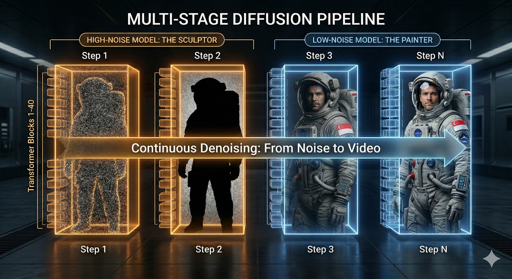
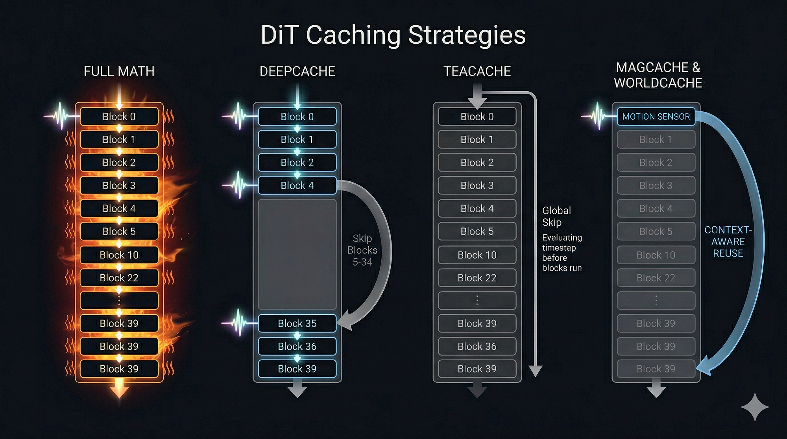

# Beyond the Hardware: A Technical Guide to Diffusion Caching Methods and Video Quality Determination

> **Originally Published on Medium:** [https://medium.com/@engineerbharath/beyond-the-hardware-taming-diffusion-math-with-context-aware-caching-7fc899feeb6d](https://medium.com/@engineerbharath/beyond-the-hardware-taming-diffusion-math-with-context-aware-caching-7fc899feeb6d)  
> **Author:** [Bharath Rathinam](https://github.com/engineerbharath12) · **Published:** Sat, 04 Apr 2026 13:17:11 GMT  
> **Track:** GPU Supercomputing & Systems Architecture

---

In my previous article, [*Breaking the Economic Barrier: High-Efficiency Video Generation on Mid-Tier Blackwell Clusters*](https://medium.com/@engineerbharath/breaking-the-economic-barrier-high-efficiency-video-generation-on-mid-tier-blackwell-clusters-aaf5d6ff2018), we explored the infrastructure side of high-performance inference. By combining advanced parallelism strategies with specialized P2P implementations on G4 instances, we established a “Zero-Bubble” pipeline that maximizes hardware utilization.

However, infrastructure orchestration is only one side of the coin. To reach true real-time interaction, we must look beyond how the data moves and address how the data is processed. Improving pipeline efficiency is fundamentally incomplete without addressing the computational redundancies within the model itself. Infrastructure ensures the hardware is never idle, but computational efficiency — the art of reducing the actual mathematical load — is what finally breaks the latency barrier.

This transition from infrastructure to algorithm leads us to **Diffusion Caching**. By implementing intelligent shortcuts that bypass unnecessary calculations, we can drastically reduce the floating-point operations required per frame, fundamentally changing our approach to video generation and world modeling.

### Technical Breakdown: Refinement from Noise

To understand why caching is the primary lever for inference speed, we first need to look at how a modern video model like Wan2.2 utilizes its compute budget. The pipeline operates in four distinct stages:

* **Text Encoding:** Converting human prompts into mathematical embeddings (via T5).
* **VAE Encoding:** Compressing the reference image into a dense spatial latent.
* **The DiT (Diffusion Transformer) Denoising Loop:** The primary processing stage.
* **VAE Decoding:** Decompressing the final latent back into a high-resolution video.

The **DiT** is the most computationally intensive part of the process, often accounting for over 70% of total pipeline latency.

The DiT generates video by iteratively removing noise from a Gaussian starting point. This is effectively like sculpting a statue from raw granite: the model starts with a block of pure noise and, through repeated passes, removes the “unnecessary stone” (noise) to leave the intended video part of the frame intact. This process is computationally heavy because it requires executing a stack of 40 Transformer blocks for every single denoising step.

### The Boundary: High Noise vs. Low Noise

The denoising trajectory is split by a specific mathematical **Boundary ( **governed by a parameter called Boundary — it determines when the generation should transiton from high noise to low noise models**)**:

* **High Noise (The Structural Stage):** In the early steps, the model establishes global structure. It defines anatomy, camera perspective, and the physical layout of the scene.
* **Low Noise (The Refinement Stage):** Once the core structure is established, the model crosses the boundary. It shifts to high-frequency refinement — focusing on skin pores, fabric textures, and lighting consistency.

Running 14 Billion parameters through 40 heavy attention blocks just to adjust fine skin textures is inefficient. This observation led to the development of caching strategies.

### The Caching Landscape: Strategies for Efficiency

Caching is the implementation of logic that skips certain complex computations to reduce the time required for repeated calculations. If the video features haven’t changed significantly between steps, we can bypass the full 40-block transformer stack.

Several different approaches have been developed to manage this skipping:

### 1. DeepCache (Layer-Based Skipping)

DeepCache assumes that high-level semantic features change slowly, while low-level details change quickly.

* **The Logic:** It skips the “middle” blocks of the transformer (e.g., blocks 10–30) for certain steps, reusing their previous outputs and only calculating the early and late layers.
* **The Trade-off:** This is a static, pre-defined skip that does not account for the actual content of the video.

### 2. TeaCache (Step-Level Evaluation)

TeaCache evaluates the relative difference between timesteps to decide if an entire denoising step can be skipped.

* **The Logic:** It calculates the distance between current and previous outputs. If the redundancy is high, it bypasses the entire step.
* **The Trade-off:** It relies on global metrics, which can miss small but important movements like a subtle facial expression.

### 3. MagCache (Magnitude-Based Sensor)

MagCache introduces a “Zero-Order Hold” (ZOH) mechanism.

* **The Logic:** It runs only the very first layer (Block 0) as a “Motion Sensor.” It measures the magnitude of the change. If the drift is below a specific threshold, it skips the remaining 39 blocks and uses an exact copy of the previous step’s output.
* **The Trade-off:** This effectively pauses the calculation for that step, which provides safety but can lead to stiff motion in active scenes.

*Different DiT Caching Stratergies*

### WorldCache: Context-Aware Dynamical Caching (March ‘26)

In March 2026, a new architecture addressed the limitations of previous methods: [**WorldCache: Content-Aware Caching for Accelerated Video World Models**](https://arxiv.org/abs/2603.22286).

WorldCache identified that treating caching as a simple copy (Zero-Order Hold) can lead to artifacts. Instead of just copying the previous frame, WorldCache implements **Context-Aware Residual Caching**.

It uses a **Block-0 Probe** to detect motion, but instead of a binary skip, it calculates the mathematical difference (the **Delta** or **Residual**) between steps. It then **adds that Delta** to the previous output: Output = Previous_Output + Motion_Delta

This allows the textures from the previous frame to mathematically follow the motion of the current frame, providing smooth motion without a full 40-block calculation.

### The Distillation Challenge: Navigating Rapid Step Changes

While WorldCache is an advanced method, applying caching to hyper-distilled models requires a careful approach. In modern production environments, we frequently use **4-Step Lightning LoRAs** to achieve fast generation times.

A significant engineering challenge here is that **distilled models undergo extremely rapid changes between steps.**

To generate a video in just 4 iterations, the model makes massive jumps across the noise timeline. When you attempt to skip steps or inject additive Residual math across these large gaps, the changes are so drastic that the math can become unstable. Adding large deltas to the hidden states can exceed the expected tensor ranges, resulting in pixelated artifacts.

**Implementation Recommendation:** For these 4-step scenarios, we suggest a hybrid, **Context-Aware Zero-Order Hold**. Rather than using additive math, use a motion sensor (like the WorldCache probe) to protect high-motion sequences by running the full math, and only skip when the scene is sufficiently stable. This ensures speed while maintaining visual accuracy.

### Quantitative Evaluation: Measuring Accuracy

Because skipping computations changes the trajectory of the model, visual inspection alone is not enough. We must programmatically measure the impact of these optimizations.

We implemented a Python evaluation pipeline to compare **Optimized Cached Videos** against **Full-Math Ground Truth** videos using three standard metrics:

* **PSNR (Peak Signal-to-Noise Ratio):** Measures absolute pixel-level accuracy.
* **SSIM (Structural Similarity Index):** Verifies that the structural layout and anatomy remain intact.
* **LPIPS (Learned Perceptual Image Patch Similarity):** Uses a neural network to ensure the video meets human perceptual standards.

### Establishing Safe Thresholds

Apart from just looking at the average score, we recommend monitoring the **Worst-Case Frame** in the 81-frame video. For a 4-step pipeline, an acceptable threshold for production is typically an **Average SSIM > 0.95** and **LPIPS < 0.05**.

This data-driven approach allows you to find the “Golden Threshold” where generation time is reduced with only a marginal, humanly imperceptible change in quality.

### Conclusion

The implementation of caching is becoming a standard practice for running high-fidelity models efficiently. By combining context-aware motion sensors with detailed frame-by-frame validation, we can build intelligent systems that maintain quality while significantly reducing latency.

---

### Links & References
* **Original Medium Post:** [Beyond the Hardware: A Technical Guide to Diffusion Caching Methods and Video Quality Determination](https://medium.com/@engineerbharath/beyond-the-hardware-taming-diffusion-math-with-context-aware-caching-7fc899feeb6d)
* **Part of:** [Bharath's AI Infrastructure Playbook (BRs-AI-Infra-Playbook)](../../README.md)
