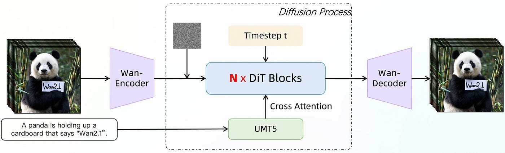
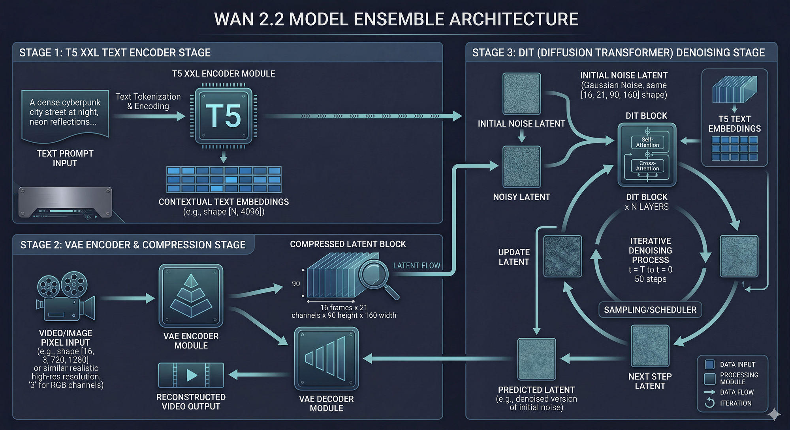
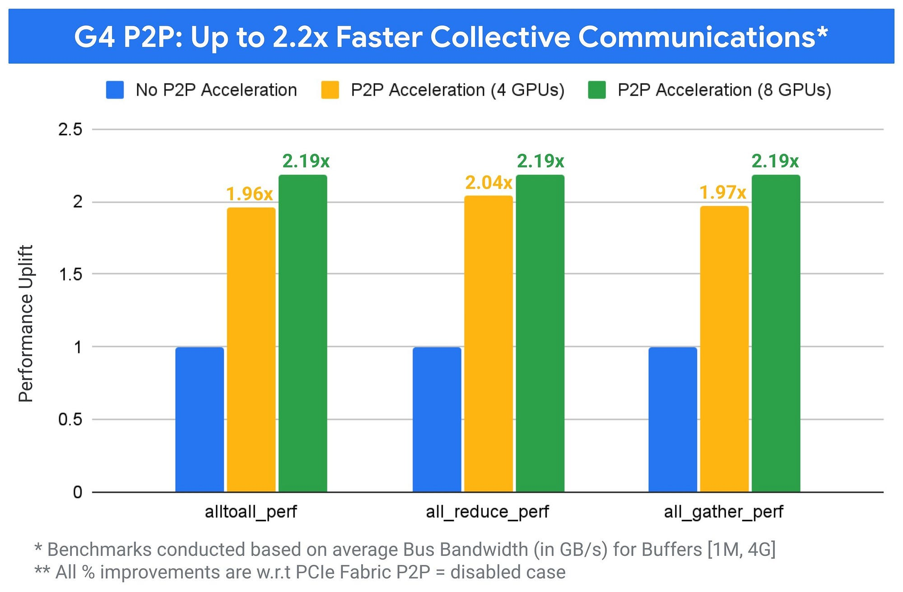

# Breaking the Economic Barrier: High-Efficiency Video Generation on Mid-Tier Blackwell Clusters

> **Originally Published on Medium:** [https://medium.com/@engineerbharath/breaking-the-economic-barrier-high-efficiency-video-generation-on-mid-tier-blackwell-clusters-aaf5d6ff2018](https://medium.com/@engineerbharath/breaking-the-economic-barrier-high-efficiency-video-generation-on-mid-tier-blackwell-clusters-aaf5d6ff2018)  
> **Author:** [Bharath Rathinam](https://github.com/engineerbharath12) · **Published:** Sat, 28 Mar 2026 11:07:23 GMT  
> **Track:** GPU Supercomputing & Systems Architecture

---

### Breaking the Economic Barrier: High-Efficiency Video Generation on Mid-Tier Blackwell Infrastructure

### 1. The Economics of Availability: Training vs. Serving

In the current compute reality, a sharp divide has emerged between training and inference infrastructure. High-end accelerators — like the NVIDIA H200, B200, GB200 series, and TPUV7x/Ironwood — are the lifeblood of large-scale training clusters. These chips boast massive HBM bandwidth and ultra-fast interconnects (NVLink/InfiniBand) designed to handle the heavy synchronization of distributed training. Consequently, these chips are both expensive(comparatively) for serving and suffer from limited availability , as they are overwhelmingly reserved for training the next generation of foundation models.

For production inference, the industry must pivot toward mid-tier accelerators like Google’s G4 instances (NVIDIA RTX Pro 6000). While these chips feature the latest Blackwell architecture and a significant 96GB of VRAM, they lack the 900 GB/s NVLink fabric. To achieve a sustainable serving strategy, we cannot simply port training code; we must design inference pipelines that specifically exploit mid-tier hardware physics to meet strict cost mandates, such as generating video at a target cost of 0.x cents per second.

### 2. The Computational Weight: Pixels vs. Text Tokens

The complexity of inferencing diffusion models like Wan 2.2 is fundamentally different from Large Language Models (LLMs). LLMs are autoregressive; they predict a single text token at a time during the decode stage.

Diffusion models, however, are non-autoregressive iterative solvers. They operate by denoising a massive, multi-dimensional block of data simultaneously. It is generally established that generating a single pixel of video requires approximately 100x more FLOPs (floating-point operations) than generating a single text token. When generating high-fidelity video, the math isn’t just “wide” — it’s “deep,” requiring multiple forward passes (steps) through the entire transformer stack to resolve a single frame.

### 3. Technical Anatomy: The Wan 2.2 Ensemble

It is important to note that Wan 2.2 is not a single model; it is a massive ensemble. While the core Diffusion Transformer (DiT) is 14 Billion parameters, the entire loaded pipeline approaches 19 Billion parameters. Understanding the hand-off between these components is critical for identifying bottlenecks:

* **T5 XXL (Text Encoder):** A massive ~4.7B parameter encoder that translates natural language into high-dimensional embeddings.
* **VAE (Variational Autoencoder):** The bridge between raw pixel space and latent space. A 5-second video at 720p resolution is too large to process directly. The VAE compresses the raw RGB pixels into a smaller, denser mathematical representation known as “latents.” For a 720p video, this compression results in a latent block measuring 16 channels by 21 temporal frames by 90 height by 160 width.
* **DiT (Diffusion Transformer):** The 14B parameter core where the actual video generation occurs. It utilizes a 3D-Aware architecture with interleaved self-attention (looking at patterns within the video itself) and cross-attention (looking at the text prompt provided by the T5 encoder).

*WAN 2.2 Architecture*

*WAN 2.2 I2V video Generation Flow*

### The Sequence Length Bottleneck

While 96GB of HBM on a G4 GPU is sufficient to load this entire ensemble into memory, the “sequence length” during the DiT stage is the primary performance killer.

In a transformer, the “sequence” is the total number of individual blocks (patches) the attention mechanism must look at simultaneously. By flattening the 21 x 90 x 160 latent space into patches of 1x2x2, the DiT must process a sequence of exactly **75,600 patches**.

For a single GPU, calculating self-attention across 75,600 patches is quadratically expensive. On a standalone mid-tier chip, generating a single 5-second clip can take minutes to resolve — an unacceptable latency for end users.

### 4. Exploiting the G4’s P2P: Ulysses Sequence Parallelism

Can we pool multiple chips together, considering the lack of NVLink, and spread the model across different GPUs to make it efficient? Yes, but we must choose the right strategy.

We must move away from “chatty” Tensor Parallelism (TP) which splits the model weights across GPUs. TP requires heavy All-Reduce communication operations after nearly every layer, which instantly saturates a standard PCIe bus.

Instead, we utilize **Ulysses Sequence Parallelism (USP)**, a breakthrough architecture introduced by Microsoft’s DeepSpeed team designed specifically for scenarios where ultra-high-speed communication is not available.

In the Ulysses strategy, the full model layers reside entirely on every single GPU, but the 75,600-patch sequence is distributed.

* **Local Computation:** Each GPU computes the Query, Key, and Value (Q, K, V) projections only for its specific slice of the sequence.
* **The All-to-All Collective:** Only during the critical attention mechanism does communication occur. The GPUs perform a high-speed All-to-All operation to trade their sequence shards for specific attention heads. GPU 0 handles all the patches, but only for Heads 1–5, GPU 1 handles Heads 6–10, and so on.
* **The PCIe Advantage:** All-to-All is a reduced-size communication operation. It moves significantly less data than All-Reduce. This plays perfectly to the strengths of Google’s G4 instances, which feature a proprietary P2P implementation offering 2.2x better NCCL performance over regular PCIe 5.0. This allows the heavy denoising steps to be parallelized efficiently.

*G4’s P2P Advantage*

### 5. Algorithmic Efficiency: SageAttention & Lightning

Beyond communication, we optimize the compute cores using two primary enablers:

* **SageAttention:** Standard attention layers struggle with the memory pressure of 75,600 patches. SageAttention (introduced to bridge the gap between quantization and speed) uses quantized Q, K, and V tensors. By reducing the precision of the attention scores without losing visual accuracy, it drastically cuts the memory footprint of the KV-cache, allowing for higher utilization on the Blackwell silicon.
* **Lightning LoRA:** By merging specialized “Lightning” weights at runtime, we reduce the required denoising process from 50 steps down to just 4. This heavily reduces the generation time.

Ulysses SP and SageAttention are already supported in open source serving engines like SGLang . We can take full advantage of the best communication and parallelism strategies available for mid-tier chips. This delivers a massive cost benefit for generating media for internal workloads compared to renting high-end accelerators.

### 6. To Be Continued…

However, these parallelism strategies and attention kernels are not the only optimization levers available to reduce costs further.

We haven’t optimized the entire stack yet for compute and communication. Furthermore, every Blackwell GPU contains native, dedicated media engines (NVJPEG, NVENC, NVDEC) that currently sit idle while the CUDA cores do all the math. Can’t we use those capabilities?

Also read this piece on how we improve the efficiency by skipping some of the computational blocks of the DiT layers.
Beyond the Hardware: A Technical Guide to Diffusion Caching Methods and Video Quality Determination ([https://medium.com/@engineerbharath/beyond-the-hardware-taming-diffusion-math-with-context-aware-caching-7fc899feeb6d?pos](https://medium.com/@engineerbharath/beyond-the-hardware-taming-diffusion-math-with-context-aware-caching-7fc899feeb6d?pos) tPublishedType=repub)

---

### Links & References
* **Original Medium Post:** [Breaking the Economic Barrier: High-Efficiency Video Generation on Mid-Tier Blackwell Clusters](https://medium.com/@engineerbharath/breaking-the-economic-barrier-high-efficiency-video-generation-on-mid-tier-blackwell-clusters-aaf5d6ff2018)
* **Part of:** [Bharath's AI Infrastructure Playbook (BRs-AI-Infra-Playbook)](../../README.md)
