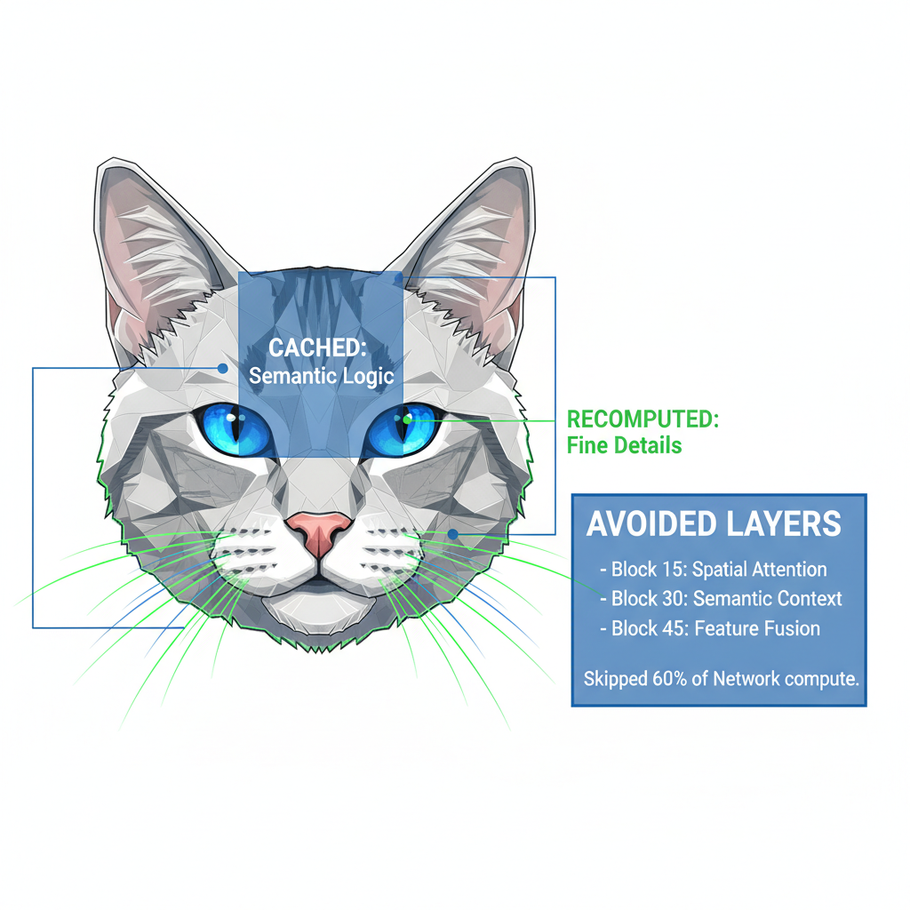
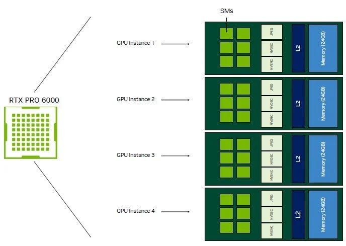
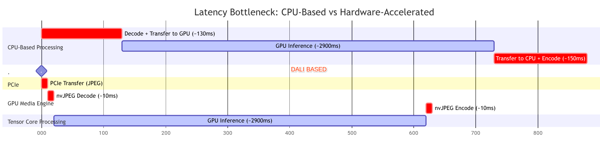

# Accelerating Vision Transformers: Breaking the I/O Wall with NVIDIA Media Engines & DeepCache Architecture

> **Author:** [Bharath Rathinam](https://github.com/engineerbharath12) · **Published:** Sat, 21 Feb 2026 05:16:40 GMT  
> **Track:** GPU Supercomputing & Systems Architecture

---

### **Accelerating Vision Transformers: Breaking the I/O Wall with NVIDIA Media Engines & DeepCache Architecture**

### The Mission: Chasing the Physical Limit

In high-performance AI engineering, we often fall into the trap of “Compute Fundamentalism.” We obsess over TFLOP counts and HBM bandwidth, assuming that if we throw enough Tensor Cores at a problem, latency will simply vanish. We treat the GPU as a monolithic math engine, forgetting that it is a complex orchestration of specialized silicon.

The secret powerhouse of NVIDIA GPUs is the **Media Engine** — dedicated silicon blocks that offload the main Tensor Cores for media decoding and encoding, crucial for image and video generation. Specifically, the **NVIDIA RTX Pro 6000 (Blackwell)** GPU, available as the G4 machine type in Google Cloud, features an enhanced, latest-generation media generation compute engine. These specialized engines can be leveraged for image/video generation models along with the NVIDIA DALI software library to optimize I/O. For more information on DALI, visit the [NVIDIA DALI documentation](https://developer.nvidia.com/dali).

Recently, during a mission to optimize the **Qwen-Image-Edit-2511** pipeline on the **NVIDIA RTX 6000 Ada (Blackwell)**, we hit a sobering reality. Despite having high no vCPUs and the latest Blackwell-class silicon, our end-to-end 1080p generation was stuck at **~5 seconds**. The math was fast, but the pipeline was “Stop-and-Go.” We weren’t in the **optimized State **squeezing every last compute power of the chip.

This article deconstructs how we broke through the I/O wall to achieve a **3.48s** generation time — hitting the theoretical physical limit of the hardware by looking beyond the Tensor Core. However additional optimization is still possible with custom cuda kernels or latest flash attention mechanisms. We need to explore further on this.

### 1. DeepCache: Architecture of Redundancy

After optimizing the initial compute phase, we attacked the Transformer’s internal architecture using **DeepCache** ([based on the Deepcache research paper)](https://arxiv.org/abs/2312.00858)

#### The Functional Hierarchy

Deep neural networks are hierarchical. In a 50-block model like Qwen:

* **Shallow Layers (0–15):** High-frequency features (Edges, fine fur texture). These change rapidly every step.
* **Deep Layers (15–45):** Low-frequency semantic features (The “Concept” of the cat, eye placement, global lighting).

#### The 15–45 Strategy

DeepCache exploits **Temporal Redundancy**. We realized that the “Concept of the Cat” doesn’t change significantly between Step 2 and Step 3.

* **The Cache Step:** We run all 50 blocks and save the output of the semantic core.
* **The Skip Step:** We run the first 15 blocks, **skip blocks 15 through 45 entirely**, and then re-inject the cached semantic “delta” before running the final layers.

By skipping **60% of the network** every other step, we transformed a 50-layer beast into a 20-layer lightweight model for 50% of the inference.

* **Result:** This optimization reduced latency to **3.76s**.
* **Quality:** Because we continue to recompute the high-frequency layers (0–15), the whiskers and fur remain pin-sharp( accuracy loss is negligible).
* **Needs Tweaking: **The efficiency gains of DeepCache are highly configurable via the block-range selection. We suggest a benchmark-led
 approach to tuning the skip-ratio, allowing for granular control over throughput speedups while maintaining the
 high-fidelity output necessary for production-grade generative media


*How Deepcache skips redundant computation*

### 2. Breaking the I/O Wall: Hardware Acceleration with NVIDIA Media Engines and DALI

At **3.76s**, we hit the “I/O Wall.” Our GPU was now so fast that it was spending **~300ms** just waiting for the CPU to feed it data. This is the **Bottleneck Bubble**.

#### The Bandwidth Math

Standard image editing requires an input image.

```
1080p Image (Raw RGB, FP32):
1920 * 1080 * 3 * 4 bytes ≈ 25 MB
Compressed JPEG: ≈ 150 KB
```

#### The PIL Sequential Bottleneck

In the standard flow, the CPU decodes the 150KB JPEG into a 25MB raw tensor. It then pushes that massive 25MB blob over the PCIe bus. On a busy server, this “Fat Transfer” causes a massive delay. The GPU Tensor Cores sit idle while pixels crawl over the bus.

#### NVIDIA Media Engines: Evolution and Architecture

NVIDIA GPUs have evolved beyond mere math accelerators. While Tensor Cores dominate AI training, the Media Engines — comprising NVDEC, nvJPEG, and NVENC — handle the heavy lifting of pixel-based I/O. For instance, the Blackwell architecture features multi-instance hardware decoders capable of 8K throughput, allowing the GPU to consume raw video and image bitstreams without taxing the vCPU.


*RTXPRO6000 with NVENC,NVDEC(Video) and JPEG(image ) compute units*

#### Optimization in Generative AI Workflows via DALI

In generative AI, especially for image-to-image or video translation, the bottleneck often lies in the pre-processing stage. Decoding a high-resolution JPEG on the CPU using libraries like PIL or OpenCV creates a massive raw tensor that must then be copied to the GPU. NVIDIA DALI (Data Loading Library) bypasses this by moving the entire decoding and augmentation pipeline into the Media Engines.

#### The Zero-Copy Handoff via DALI

We used **NVIDIA DALI** to implement a “Hardware-Native” stream:

* **Thin Pipe Transfer:** We send the **compressed 150KB bitstream** over PCIe (Microseconds).
* **GPU-Native Decode:** The **nvJPEG engine** decodes the JPEG directly into VRAM.
* **The Teleport:** Using the __cuda_array_interface__, we pass a memory pointer to PyTorch.

The data **never touches the CPU L3 cache and stays within the GPU**. This eliminated the 280ms CPU-sequential overhead.

* **Result:** Latency dropped from **3.76s to 3.48s**.


*Diff. between CPU based Image processing vs GPU-media engine encode-decode offloading*

### 3. Breaking the Launch Wall: CUDA Graphs

### The “Launch Latency” Problem

GPUs are asynchronous, but the CPU-to-GPU “Command Queue” introduces significant **Launch Latency**. Every kernel launch (e.g., a convolution or attention head) incurs a 10–20 us driver overhead. In a 50-block model with thousands of kernels, this aggregates to **~1 second of idle GPU time** across an inference run.

* **Context Switch Cost:** Every time Python calls conv2d, there is a CPU-to-Driver-to-GPU latency of roughly 10–20us.
* **The Scale:** A 50-block Transformer has thousands of kernels. 20us* 1000 = 20ms per step. Over 50 steps, that’s **1 second of pure idle time**.

### The CUDA Graph Solution

**The Solution:** torch.compile(mode=’reduce-overhead’) captures the entire kernel sequence into a single **CUDA Graph Node**. The CPU issues one command, and the GPU self-schedules the entire workload, reclaiming the launch overhead and dropping latency from 4.03s to 3.76s.

**Execution Flow:**

* **CPU:** “Launch Graph ID #1” (1 command).
* **GPU Command Processor:** Reads the graph from memory and self-schedules 1,000 kernels.
* **Dependency Handling:** The GPU handles memory barriers and synchronization internally without checking back with the CPU.

**Why it mattered for DeepCache:** DeepCache makes the GPU part extremely fast (~2.9s). This exposes the CPU launch overhead as a major percentage of total time. By using CUDA Graphs, we reclaimed that lost time, dropping latency from

### Conclusion: The Golden State of Generative Media

We have entered an era where **fast inference** is no longer about brute-force compute; it is about structural harmony. Our **3.48s benchmark** on the RTX 6000 proves that the true “Speed of Light” for models like Qwen-Image-Edit and WAN is achieved only when algorithm and silicon move in unison.

The path to efficiency relies on two fused strategies:

* **Algorithmic Efficiency (DeepCache):** Mathematically eliminates 60% of redundant Transformer compute.
* **Hardware-Native I/O (NVIDIA Media Engines):** Replaces the 300ms CPU-sequential bottleneck with a continuous, **zero-copy stream** that flows directly from disk to VRAM to the Tensor Core.

For the next generation of visual AI, the focus must shift: Look beyond the **TFLOP**. The most efficient pipelines will be those that respect the physics of the entire die, offloading pixel logistics to dedicated media silicon and leaving the Tensor Cores free to create.

---

### Links & References
* **Part of:** [Bharath's AI Infrastructure Playbook (BRs-AI-Infra-Playbook)](../../README.md)
