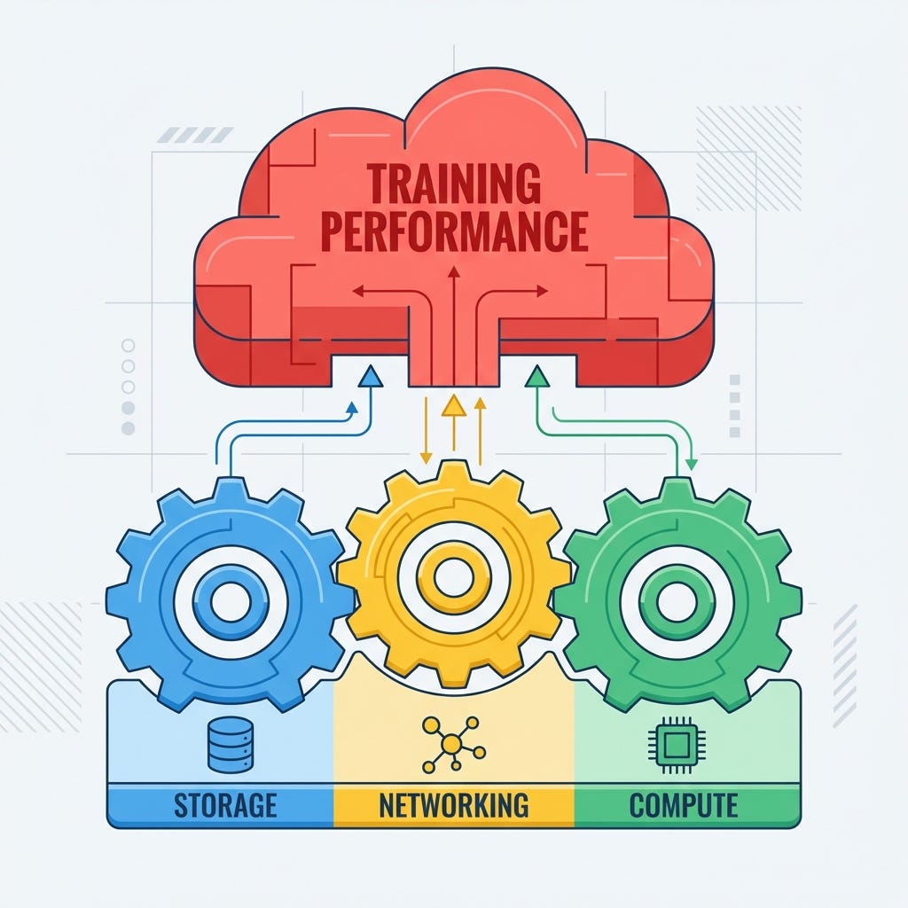
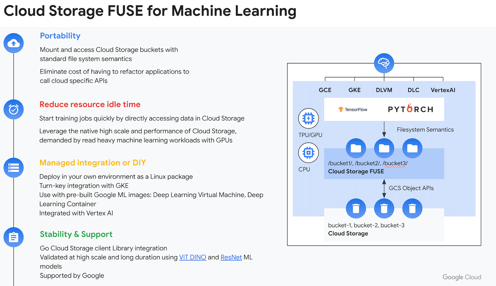
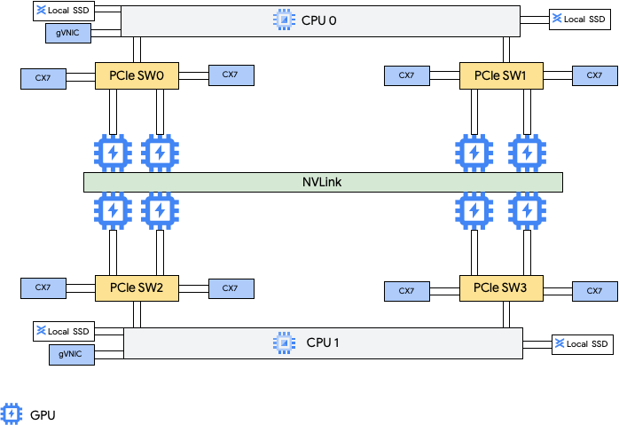

# The Road to the Golden State: How We Optimized 70B Model Training by Focusing on MFU to Save Millions

> **Author:** [Bharath Rathinam](https://github.com/engineerbharath12) · **Published:** Sat, 10 Jan 2026 03:02:04 GMT  
> **Track:** GPU Supercomputing & Systems Architecture

---

### The Road to the Golden State: How We Optimized 70B Model Training by Focusing on MFU to Save Millions

### The Quest for MFU: Beyond GPU Utilization

I was helping a customer optimize their model training performance recently, and we found ourselves chasing a specific metric that often determines the success of large-scale AI projects: **Model FLOPs Utilization (MFU)**.

**What is MFU?** In the past, engineers would look at “GPU Utilization” — a simple metric of whether a chip is busy (i.e., kernel is running). But “busy” doesn’t mean “efficient.” You can have 100% GPU utilization while waiting for memory to fetch 80% of the time.

**MFU** measures how much of the hardware’s theoretical peak performance (TFLOPS) is actually being translated into useful model arithmetic. It’s the “real” efficiency score.

When training runs span thousands of GPUs, the difference between “busy” and “efficient” is massive. We found that optimizations raising Effective MFU from a baseline of **27% to 45%** didn’t just speed up the run; for a large-scale training job (like a 70B model on 15T tokens), this efficiency gain translates to an estimated **$1.6 Million in savings**.


*Figure 1: AI Infrastructure as a Tripod: Storage, Networking, and Compute are interdependent.*

### The Engine: MaxText and the Power of JAX

To achieve this “Golden State” of optimization, we utilized **MaxText** on **Google Cloud’s A3 Ultra** machines.

MaxText is a high-performance, open-source LLM framework written in pure Python and JAX. It allows us to train on massive clusters of **NVIDIA H200 GPUs** connected by **8 Mellanox switches** (achieving 3.2 Tbps aggregate bandwidth), efficiently leveraging the specific hardware blocks without writing custom kernels.

When deployed on A3 Ultra or TPUs, MaxText leverages the XLA compiler to handle complex sharding strategies automatically.

[!NOTE] Google Cloud also provides the **Cluster Toolkit**, **XPK** (Accelerated Processing Kit), and **Cluster Director**, which streamline the deployment of these highly complex infrastructures. For standardized configurations, check out the [MaxText Recipes](https://github.com/google/ai-hypercomputer/tree/main/maxtext_recipes) in the AI Hypercomputer repository.

### The Holistic Approach

Like every infrastructure-based solution, optimal training is a complex interplay of **Storage**, **Compute**, and **Networking**. You cannot optimize one in isolation; a stall in storage starves the compute, and a slow network bottleneck prevents the accelerator from utilizing its full memory bandwidth.

Today, we’ll look at the specific optimizations we applied at each layer to achieve that 45% Effective MFU, and how Google Cloud’s specific differentiators helped us get there.

### 1. Storage: Eliminating the I/O Bottleneck

Infrastructure optimization is a delicate balance. Our storage journey began with **Cloud Storage FUSE (GCS FUSE)**, which allows us to mount GCS buckets as local file systems. This is critical for cloud-native training, but out-of-the-box settings aren’t enough for the extreme throughput demands of 70B model training.

On GKE, GCS FUSE is deployed via a **CSI driver** that injects a sidecar container into your training Pods. This sidecar handles the FUSE mount and data transfer, meaning its resource allocation is critical to performance.


*Figure 2: Cloud Storage FUSE Architecture for ML Workloads*

### A. Training Data Optimization (Read-Optimized)

**Requirement:** High-throughput random reads of small files.

To ensure the training data was always ready for the GPUs, we utilized **Local SSD Caching**. We mapped the GCS FUSE cache to the node’s local NVMe (/tmp). This ensures that after the first epoch, data is read from local disk at **3GB/s** instead of traversing the network.

```
Config Applied: file-cache:max-size-mb:-1 + enable-parallel-downloads:true.
```

We also leveraged Grain, a high-performance, deterministic data loader built specifically for JAX. Grain acts as the backbone of reliability for MaxText and provides two critical advantages:

**Cache Affinity: **Grain uses index-based shuffling to strictly control which worker reads which data. This determinism ensures that after the first epoch, each worker hits near 100% cache rates on the Local SSDs, preventing disk thrashing.
**Precision Resume:** Unlike standard loaders that struggle with state, Grain is stateful by design. If a MaxText job is preempted at step 50,000, Grain resumes mathematically instantly from that exact token index. This guarantees zero data loss or duplication, a non-negotiable requirement when training on trillions of tokens across thousands of preemptible nodes

### B. The Checkpoint Challenge (Write-Optimized)

Checkpoints are vital for handling failures AND for resuming training efficiently. In our baseline, writing checkpoints was a blocking operation that stalled training for over **5 minutes** (for a 140GB checkpoint upload), dragging our Effective MFU down to ~27%.

### The Solution: HNS and Optimization

We implemented a **Split Strategy** using Kubernetes PersistentVolumes (PVs) to tune the read and write paths differently.

* **Hierarchical Namespace (HNS):** We enabled HNS on our buckets. Standard object storage simulates directories, meaning a “rename” of a checkpoint folder with thousands of files uses thousands of slow copy+delete operations. HNS makes directory moves atomic.
* **Streaming Writes:** We enabled write:enable-streaming-writes:true. This bypasses the local disk cache. Without it, the massive burst of checkpoint data would fill the local disk implementation, causing “Too many open files” crashes.
* **Sidecar Resources:** We patched the GCS Fuse CSI driver to allocate **4 vCPUs** (up from 0.5) to the sidecar, ensuring the FUSE process could saturate the network bandwidth.

**The Impact:** These changes reduced the checkpoint stall from ~312 seconds to just **2.8 seconds** — a **99% reduction**. This transformed checkpointing from a heavy blocking penalty into a near-instant background task.

### 2. Compute: Maximizing Arithmetic Intensity

The goal of compute optimization is to ensure the **H200 GPUs** (or any modern accelerator) are fully utilized. This requires a precise balance of model length, batch size, and memory management (activation memory vs. weight memory).

### The Memory Barrier

With the Reference 70B model, our baseline configuration for the number of nodes we used could only fit a **per-device batch size of 1**. This left the massive compute engines starving for work, resulting in a Peak MFU of just 35.1%.

### The Fix: Rematerialization

We adjusted the **Rematerialization Policy** in MaxText.

* **From:** save_dot_with_context_except_mlp
* **To:** full

“Full” rematerialization means we recompute more activations during the backward pass rather than storing them in High Bandwidth Memory (HBM). This trade-off — trading compute for memory — freed up massive amounts of HBM.

**The Impact:** This strategy freed enough memory to **quadruple (4x) the batch size** from 1 to 4. The higher batch size increased the arithmetic intensity, allowing the Tensor Cores to shine. This step trades compute for memory and involves recomputation of activation memory during backward pass but we observed the overall gains were making sense.

* **Peak MFU:** Jumped from 35.1% to **45.8%**.
* **Throughput:** Overall training speed increased by **~30%** from compute optimizations alone.

### 3. Networking: The 3.2 Tbps Superhighway

In a multi-node setup, the network is the glue. A3 Ultra features **8 Mellanox NICs** achieving **3.2 Tbps** of inter-node bandwidth over **RoCE** (RDMA over Converged Ethernet).

MaxText uses **NCCL** (NVIDIA Collective Communications Library) for cross-device communication. To verify our fabric, we used NCCL tests to measure the bus usage for critical collectives like all_gather and reduce_scatter.


*Figure 3: A3 Ultra Machine Architecture showing 8x H200 GPUs and NVSwitches*

### The Optimization Knobs

We tuned several parameters to saturate this pipe:

* **NCCL_ALGO=Ring,Tree:** Allowing NCCL to dynamically choose the best algorithm.
* **NCCL_MIN_NCHANNELS=4:** Optimizing the number of concurrent channels for our message sizes.

**Note:** There are plenty of other knobs (e.g., **NCCL_CROSS_NIC, NCCL_BUFFSIZE**), but these often yield marginal improvements or, in some cases (like increasing buffer size), can lead to OOMs. This complexity is why manual tuning is difficult.

### The Google Differentiator: gIB NCCL Tuner

This is where the **gIB NCCL Tuner** comes in.

This Google Cloud plugin uses topology-aware logic to map logical ranks to the physical rails of the Jupiter fabric. It ensures that your GPU is never starved waiting for model weight updates or gradients. The Tuner automatically discovered the efficient topology and matched our best manual tuning efforts without requiring trial-and-error, ensuring we hit ~388 GB/s algorithm bandwidth (close to the hardware limit).

### Conclusion: The Golden State

Optimizing a training pipeline requires looking at the holistic picture. By aligning **Storage** (eliminating stalls with HNS and parallel reads), **Compute** (maximizing batch size via rematerialization), and **Networking** (topology-aware tuning), we achieved a dramatic efficiency boost.

* **Effective MFU:** Increased from **27% to 45%**.
* **Training Speedup:** **~75% faster** overall.

These results prove that infrastructure architecture matters. For ML engineers, this means that with the right configurations on A3 Ultra, you can stop debugging infrastructure and start focusing on what you do best: building the future of AI.

---

### Links & References
* **Part of:** [Bharath's AI Infrastructure Playbook (BRs-AI-Infra-Playbook)](../../README.md)
