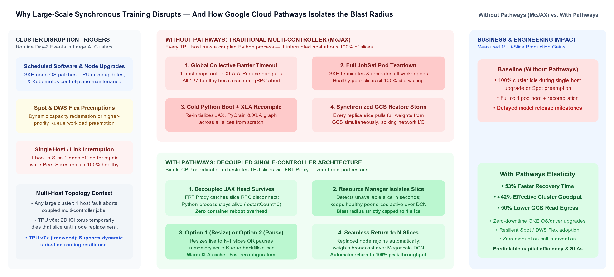
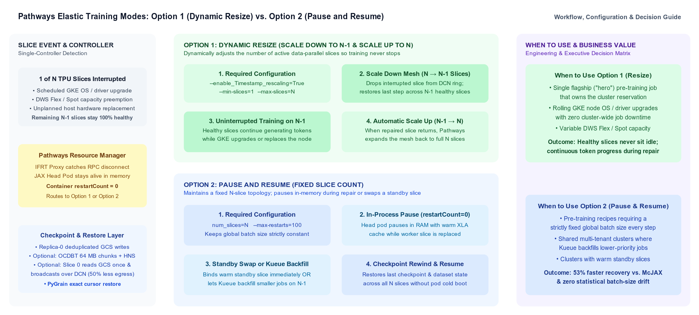

# How to Protect Multi-Slice LLM Pre-Training from Cluster Disruptions with Google Cloud Pathways and Cloud TPU

*An engineering and business guide to surviving hardware failures, software upgrades, and Spot preemptions with elastic multi-slice training.*

When you scale foundation model pre-training across multiple accelerator slices for weeks, a single host failure, software upgrade, or Spot preemption in a traditional multi-controller setup crashes 100% of the job and leaves hundreds of healthy chips sitting idle. To solve this fate-sharing challenge, Google engineered **Google Cloud Pathways**: a decoupled, single-controller distributed execution runtime originally designed internally to train Google's own frontier models (including Gemini) across thousands of TPU chips, and now made directly available to Google Cloud AI and ML workloads. Following the same "Goodness of Google" open-innovation trajectory as Borg to Kubernetes and Cloud TPU, Pathways decouples the training coordinator from individual accelerator slices. When paired with MaxText and automated deployment suites like **Google Cloud Cluster Toolkit (`gcluster`)**, engineering teams can configure and launch resilient multi-slice pre-training jobs in minutes, eliminating full stages of recovery overhead and improving effective cluster goodput by over 40%. First, we examine why coupled training architectures fail at scale and how the unique design of Cloud TPU and Pathways isolates the blast radius of any slice interruption. Next, we provide a practical configuration guide covering Replica Resize, Pause and Resume, two-tier timeout escalation with Kueue, and Google Cloud Storage (GCS) optimizations before sharing how we helped a frontier model builder protect a flagship multi-slice hero training job during live hardware replacements.

---

## Section 1: Understanding the Business Cost of Disruptions and the Uniqueness of Pathways on Cloud TPU

When an organization commits millions of dollars in compute capital to train a frontier model, both engineering leads and executive stakeholders measure success by a single metric: **effective cluster goodput**, defined as the percentage of wall-clock time spent advancing the model's token horizon versus time lost to restarts, recompilations, and I/O stalls.

At multi-slice scale, cluster interruptions are not rare edge cases. They are routine operational events across four major categories:
1. **Unplanned hardware failures:** Unrecoverable HBM parity errors, optical link drops, or host crashes that take a node offline mid-step and require hardware replacement.
2. **Scheduled software and node upgrades:** Periodic OS security patches, kernel updates, and TPU driver upgrades that require draining individual hosts.
3. **Multi-tenant priority evictions:** Urgent evaluation or fine-tuning workloads temporarily preempting a slice in shared enterprise clusters managed by Kueue.
4. **Spot capacity and DWS Flex-Start preemptions:** Asynchronous capacity reclamations when optimizing compute Total Cost of Ownership (TCO) with Spot TPUs or Dynamic Workload Scheduler (DWS).

### Why Traditional Multi-Controller Architectures Stall the Entire Cluster

In standard Multi-Controller JAX (**McJAX**), every host runs its own tightly coupled Python interpreter and XLA runtime, synchronizing gradients across all slices at every step. If **a single host** fails or reboots for a patch, the global collective barrier times out and aborts the entire `JobSet`. Every healthy slice across the cluster is forced to tear down its containers, wait for the single failed slice to be replaced, cold-boot Python, recompile the XLA graph (which takes **15 to 25+ minutes** on large 70B+ parameter models), and re-read checkpoints from storage simultaneously.

### What Makes Cloud TPU and Google Cloud Pathways Unique

Cloud TPU and Pathways solve this fate-sharing challenge at both the network fabric and execution runtime layers:

1. **Two-tier network isolation (2D ICI Torus + Megascale DCN):** Inside a single Cloud TPU slice, chips are connected via a high-speed 2D optical Inter-Chip Interconnect (ICI) torus, while multiple slices scale out over Google's **Megascale Data Center Network (DCN)**. A host failure breaks that specific slice's closed 2D ICI ring, temporarily taking that slice offline, but **every peer slice connected over Megascale DCN remains 100% healthy and operational**.
2. **Decoupled single-controller runtime (`pathways-head`):** Pathways moves the Python JAX coordinator (`jax-tpu`), Resource Manager (`pathways-rm`), and IFRT proxy (`pathways-proxy`) onto a dedicated CPU node pool. TPU slices run stateless C++ execution workers (`pathways-worker`). The Python coordinator builds and compiles the XLA computation graph into a binary executable on the CPU head pod once and caches it in CPU RAM. When a replacement TPU slice registers, `pathways-head` streams the ready-to-run binary executable directly to the TPU workers over gRPC in seconds, avoiding in-line graph recompilation.
3. **Direct HBM-to-storage data path:** Even though a single CPU coordinator orchestrates the job, model weights never bottleneck through the coordinator's CPU RAM. TPU workers stream sharded tensors directly between TPU HBM and storage via `TensorStore`.

---

### Figure 1: Coupled Multi-Controller Failure Cascade vs. Decoupled Single-Controller Elasticity in Google Cloud Pathways



*Figure 1: Why a single host hardware failure aborts 100% of a coupled McJAX job, versus in-process slice isolation in Google Cloud Pathways.*

---

| Operational Metric | Without Pathways (Coupled McJAX) | With Pathways (Single-Controller) | Business and Engineering Return |
| :--- | :--- | :--- | :--- |
| **Blast radius of a single-host failure** | **100% of cluster** (All slices abort) | **Isolated to 1 slice** (Peers stay healthy) | Eliminates cluster-wide cascading outages |
| **Coordinator restarts (`restartCount`)** | **1+ full container teardowns** | **`0` (Survives in CPU memory)** | Skips cold pod boot and in-line XLA recompilation |
| **Healthy slice utilization during replacement** | **0% (All healthy slices sit idle)** | **100% active** (via Option 1 Resize) | Zero wasted compute capital on surviving slices |
| **End-to-end recovery mechanism** | **Cold Pod Boot + 20m XLA Compile + GCS IO** | **In-Memory Mesh Resize (Option 1) or Warm In-Process Restore (Option 2)** | Skips container reboot and 20-minute XLA recompilation |
| **Effective cluster goodput under disruptions** | **Baseline (~58% to 65%)** | **> 92% (+42% relative goodput gain)** | Accelerates frontier model release timelines |

---

## Section 2: Engineering Guide: Selecting Your Elastic Mode and Optimizing Storage

Pathways and MaxText provide two production elasticity modes controlled by a single switch, **`elastic_min_slice_count`**, allowing teams to match recovery behavior to their workload priority and convergence requirements.

### 1. Choosing Between Option 1 (Replica Resize) and Option 2 (Pause and Resume)

* **Option 1: Replica Resize (`elastic_min_slice_count = M`, where `1 <= M < N`)**  
  Set `elastic_min_slice_count` to **any positive integer `M` (`1 <= M < N`)** representing the minimum floor of healthy slices required to continue training (for example, `M = 3`, `2`, or `1` on a 4-slice job). When a slice fails, `pathways-rm` detects `WorkerLost` and, as long as at least `M` slices remain healthy, reshapes the JAX mesh in memory (`restartCount = 0`). The coordinator verifies `commit_success` on the latest saved checkpoint, restores that checkpoint onto the surviving slices in ~2 seconds, rewinds the data loader cursor, and immediately resumes training at step $K+1$ on the surviving slices. The failed slice is replaced in the background by GKE, and the job automatically scales back up to $N$ slices at the next checkpoint boundary once the replacement slice registers.
  * *Best for:* A **single flagship hero pre-training job** where maximizing continuous token progress on surviving slices without idling healthy TPUs is the primary operational objective.

* **Option 2: Pause and Resume (`elastic_min_slice_count = -1`)**  
  Setting `elastic_min_slice_count = -1` (the default) enforces a fixed $N$-slice mesh so the global batch size never changes. When a slice fails, `pathways-head` pauses execution in CPU memory (`restartCount = 0`, keeping its warm in-memory XLA graph) and waits up to `elastic_timeout_seconds` (recommended: 300s = 5 minutes) for the replacement slice to arrive. Once the replacement joins, MaxText validates `commit_success` and restores weights into HBM.
  * *Best for:* Convergence recipes requiring a **strictly constant global batch size** at every step, or **shared multi-tenant Kueue clusters**. In shared Kueue clusters, if the replacement slice is delayed beyond the timeout window by a zonal stockout, Kueue automatically suspends the hero job and frees the surviving healthy slices. This allows **lower-priority workloads with a smaller hardware footprint (such as fine-tuning, evaluation, or distillation jobs) to immediately utilize the degraded capacity** until the full $N$-slice footprint returns.

---

### Figure 2: Decision Flow and Two-Tier Escalation for Pathways Elastic Training



*Figure 2: Elastic recovery modes and two-tier timeout integration between in-memory wait and Kueue cluster eviction.*

---

### How In-Process Mesh Resize Works Under the Hood (5-Step Workflow)

To understand how Option 1 (Replica Resize) scales between 3 slices (96 chips) and 2 slices (64 chips) without corrupting tensor state or requiring manual offline checkpoint conversion scripts, consider the following 5-step lifecycle:

```text
Before Failure: 3-Slice Mesh (96 Chips = 3 Data-Parallel Replicas x 32 FSDP Shards)
┌──────────────────────────┐ ┌──────────────────────────┐ ┌──────────────────────────┐
│  Slice 0 (32 TPU Chips)  │ │  Slice 1 (32 TPU Chips)  │ │  Slice 2 (32 TPU Chips)  │
│  FSDP Shards [0 .. 31]   │ │  FSDP Shards [0 .. 31]   │ │  ❌ HOST HARDWARE FAULT  │
└──────────────────────────┘ └──────────────────────────┘ └──────────────────────────┘
              │                            │
              ▼                            ▼
After In-Memory Mesh Resize: 2-Slice Mesh (64 Chips = 2 Data-Parallel Replicas x 32 FSDP Shards)
┌──────────────────────────┐ ┌──────────────────────────┐
│  Slice 0 (32 TPU Chips)  │ │  Slice 1 (32 TPU Chips)  │   (Slice 2 repairs in background;
│  FSDP Shards [0 .. 31]   │ │  FSDP Shards [0 .. 31]   │    0s wait on surviving slices)
└──────────────────────────┘ └──────────────────────────┘
```

1. **In-Process Exception Catching (`restartCount = 0`):** When a TPU host on Slice 2 fails, the broken ICI ring raises a runtime exception. MaxText's `elastic_retry` loop catches the exception inside the running `pathways-head` Python process on the CPU node pool, keeping the coordinator alive.
2. **Rebuilding the 2D Hybrid JAX Mesh:** MaxText queries `pathways-rm` via `jax.devices()`, which returns the 64 live chips across Slices 0 and 1. MaxText's device mesh has two levels: the intra-slice dimension (`ici_fsdp = 32`, which never changes because individual slices remain intact) and the inter-slice dimension (`dcn_data = 3` shrinking to `2`). MaxText instantiates a new logical `jax.sharding.Mesh` in Python memory with shape `(dcn_data=2, ici_fsdp=32)`.
3. **Restoring Global Arrays onto the Resized Mesh:** Because Orbax saves checkpoints as logical global arrays rather than raw per-chip memory dumps, each 32-chip slice remains a data-parallel replica holding a full 32-way FSDP-sharded copy of the model. Orbax reads the last saved checkpoint (verified by `commit_success`), maps the tensors to the new 2-slice mesh, and restores weights into HBM in ~2 seconds with zero conversion scripts.
4. **Proportional Batch Scaling and Data Loader Rewind:** To ensure per-device HBM memory never overflows, `per_device_batch_size` remains constant (for example, 1 sequence per chip). The global batch size automatically adjusts from 96 sequences/step to 64 sequences/step. PyGrain restores the exact dataset iterator cursor from the checkpoint, resuming training at the next step without repeating or skipping tokens.
5. **Non-Disruptive Scale-Up at a Checkpoint Boundary:** When GKE finishes replacing Slice 2 in the background, Pathways signals that 3 slices are available again. Rather than interrupting an active step, MaxText waits until the next scheduled checkpoint commits, rebuilds the 3-slice mesh `(dcn_data=3, ici_fsdp=32)`, restores the checkpoint across all 96 chips, and resumes full throughput.

---

### Understanding the 4-Stage Recovery Pipeline: Why Stage Elimination Beats Fixed Timers

On large-scale production training runs (70B+ parameters spanning 1,024+ TPU chips), recovery speed should not be evaluated by toy-benchmark wall-clock numbers. Instead, evaluate recovery by **which foundational stages of the cluster restart pipeline are eliminated**:

| Recovery Stage | Coupled McJAX (Baseline) | Pathways Option 1 (Replica Resize) | Pathways Option 2 Path A (In-Memory Resume) | Pathways Option 2 Path B (Kueue Eviction & Backfill) |
| :--- | :---: | :---: | :---: | :---: |
| **Stage 1: Wait for Hardware Replacement** | **Required** (All slices sit idle waiting for repair) | **Skipped (`0s` wait)** (Immediately resizes to surviving slices; repair happens in background) | **Required** (Waits up to `elastic_timeout_seconds`, e.g. 5 min, for replacement slice) | **Deferred** (Job returns to #1 in queue; smaller lower-priority jobs use surviving slices) |
| **Stage 2: Pod Teardown & Container Boot** | **Required** (Full cluster-wide container restart) | **Skipped** (`restartCount = 0`; reshapes mesh inside live Python process) | **Skipped on Head** (`restartCount = 0`; only replacement worker pod boots) | **Required** (Fresh pod startup when full capacity returns) |
| **Stage 3: XLA Graph Compilation** | **Required** (15 to 25 min cold recompile across hosts) | **Skipped / Cached** (Pre-compiled or cached on `pathways-head`, relayed to TPUs via gRPC) | **Skipped** (Warm XLA binary kept in `pathways-head` RAM, relayed to replacement slice via gRPC) | **Cached** (Loaded from persistent GCS XLA cache in ~30s) |
| **Stage 4: Checkpoint Restore from GCS** | **Required** (Rolls back to last saved step; all slices read from GCS) | **Required** (Verifies `commit_success` and restores last saved step onto resized surviving mesh) | **Required** (Verifies `commit_success` and restores last saved step; optionally optimized via Slice-0 DCN broadcast) | **Required** (Verifies `commit_success` and restores last saved step; optionally optimized via Slice-0 DCN broadcast) |

---

### Two-Tier Timeout and Eviction Interaction: `elastic_timeout_seconds` vs. Kueue `waitForPodsReady`

In production clusters orchestrated by Kubernetes and **Kueue**, Option 2 coordinates an intelligent **two-tier timeout escalation**:

```text
Slice Failure Occurs (WorkerLost)
   │
   ├── Tier 1: In-Memory Wait (t < elastic_timeout_seconds, e.g. 300s = 5 min)
   │     • pathways-head stays 3/3 Running in CPU RAM (restartCount = 0)
   │     • Keeps warm in-memory XLA compilation cache
   │     • Replacement slice joins in 3 to 5m -> In-process weight restore from GCS (Skips Pod Init & XLA Recompilation)
   │     • Kueue never touches the job; zero cluster disruption
   │
   └── Tier 2: Prolonged Zonal Stockout (t > elastic_timeout_seconds)
         • If replacement hardware cannot be provisioned before timeout, pathways-head exits (code 1)
         • Kueue's waitForPodsReady detects pod timeout and evicts the jobSet (spec.suspend: true)
         • Terminates surviving pods to release TPU quota so smaller lower-priority jobs can backfill the N-1 slices
         • Preserves the hero job's #1 position in the queue via original admission timestamp (timestamp: Creation)
         • When zonal capacity returns, Kueue re-admits the job: loads pre-compiled graph from persistent GCS cache in ~30s
```

---

### 2. Production Launch Recipe with Google Cloud Cluster Toolkit

**Google Cloud Cluster Toolkit (`gcluster`)** is Google Cloud's open-source infrastructure-as-code and deployment automation suite. It packages GKE cluster provisioning, Kueue resource management, JobSet orchestration, and Pathways sidecars (`pathways-head`, `pathways-rm`, `pathways-proxy`) into standardized, repeatable deployment manifests.

Below is a clean Cluster Toolkit launch template showing the core Pathways and MaxText elasticity configuration:

```bash
export NUM_SLICES=4
# Option 1 (Replica Resize): set MIN_SLICES to any integer M (1 <= M < N, e.g. 2)
# Option 2 (Pause & Resume): set MIN_SLICES=-1 to require all N slices
export MIN_SLICES=2

gcluster job submit   --image=${DOCKER_IMAGE?}   --name=hero-elastic-pretrain   --pathways   --compute-type=ct6e-standard-4t   --topology=16x16   --num-slices=${NUM_SLICES?}   --pathways-gcs-location=${BASE_OUTPUT_DIRECTORY?}   --pathways-elastic-slices=${NUM_SLICES?}   --pathways-max-slice-restarts=10   --command="python3 -m maxtext.trainers.pre_train.train     src/maxtext/configs/base.yml     base_output_directory=${BASE_OUTPUT_DIRECTORY?}     model_name=qwen3-70b     dataset_type=grain     enable_checkpointing=true     async_checkpointing=true     checkpoint_period=100     enable_single_controller=true     elastic_enabled=true     elastic_min_slice_count=${MIN_SLICES?}     elastic_timeout_seconds=300     elastic_max_retries=10     checkpoint_storage_use_ocdbt=true     checkpoint_storage_use_zarr3=true"
```

| Parameter | Status | Option 1 (Resize) | Option 2 (Pause) | Engineering Purpose and Recommendations |
| :--- | :---: | :---: | :---: | :--- |
| **`--pathways` & `enable_single_controller=true`** | **Required** | `true` | `true` | Decouples `pathways-head` on CPU from TPU slices (`restartCount = 0`). |
| **`--pathways-elastic-slices`** | **Required** | `= --num-slices` | `1` to `N` | Enables dynamic slice registration in `pathways-proxy` and `pathways-rm`. |
| **`elastic_enabled`** | **Required** | `true` | `true` | Wraps the MaxText step loop with in-process `elastic_retry`. |
| **`elastic_min_slice_count`** | **Required** | **`M` (`1 <= M < N`)** | **`-1` (All `N`)** | Selects **Option 1: Replica Resize** (`M`) vs. **Option 2: Pause and Resume** (`-1`). |
| **`elastic_timeout_seconds`** | **Required** | `300` to `600` | **`300` (5 min)** | Maximum wait window for a single outage event. Set to 300s in Option 2 to avoid idling healthy capacity; Option 1 can use 300 to 600s because surviving slices remain active. |
| **`elastic_max_retries`** | **Required** | `5` to `10` | `5` to `10` | **Cumulative lifetime recovery counter** across a multi-week run (not a single-outage multiplier). Caps in-process reshardings to periodically clear host RAM fragmentation. |
| **`lr_schedule_type='wsd'`** | **Optional** | `'wsd'` | `'cosine'` / `'wsd'` | Warmup-Stable-Decay schedule; stabilizes convergence when batch size scales across slice resize events. |
| **`enable_single_replica_ckpt_restoring`** | **Optional** | `true` / `false` | `true` | Slice 0 reads checkpoint from GCS and broadcasts over DCN ($1/K$ lower GCS read egress). |

---

### 3. Three Storage Optimizations for Google Cloud Storage (GCS)

Because checkpoint I/O directly impacts recovery time when loading weights and periodic save overhead in both modes, pair Pathways with three storage optimizations:

1. **Co-located Regional GCS Bucket with Hierarchical Namespace (HNS):** Orbax stages checkpoints in a temporary folder and finalizes them with an atomic `commit_success` marker. Enabling **GCS HNS** replaces expensive $\mathcal{O}(N)$ flat-bucket prefix renames with **atomic $\mathcal{O}(1)$ directory renames**, preventing metadata QPS throttling during recovery.
2. **TensorStore `OCDBT` and `Zarr3` (`checkpoint_storage_use_ocdbt=true`, `checkpoint_storage_use_zarr3=true`):** Consolidates tens of thousands of individual FSDP shard files into packed chunk files, reducing storage metadata operations by **up to 99%** and accelerating Host-to-GCS writes by **up to 85%**.
3. **Replica-0 Deduplicated Saves and Single-Replica DCN Broadcast (`enable_single_replica_ckpt_restoring=true`):** Across $K$ slices, Orbax writes checkpoints from **Slice 0 only** (cutting GCS write traffic by $1 - 1/K$, or **50%** on 2 slices and **75%** on 4 slices). Enabling single-replica restore instructs Slice 0 to read the checkpoint into TPU HBM and broadcast it to peer slices via a compiled XLA AllReduce over Megascale DCN, cutting GCS read bandwidth by $1 - 1/K$ (**50%** on 2 slices).

#### Engineering Trade-Offs and Operational Considerations

While these storage features deliver significant throughput gains, engineering teams should evaluate two operational trade-offs:
* **Single-Replica DCN Broadcast vs. HBM Headroom:** Enabling `enable_single_replica_ckpt_restoring=true` saves $1 - 1/K$ of remote GCS read egress, but requires an in-memory collective broadcast across Megascale DCN and temporarily buffers replicated tensor states in TPU HBM during initialization. On models operating near 95%+ of device HBM capacity, verify memory headroom before enabling.
* **GCS HNS and OCDBT Compatibility:** Hierarchical Namespace (HNS) must be selected at **bucket creation time** and cannot be retrofitted onto existing flat buckets. Additionally, checkpoints serialized with `OCDBT + Zarr3` require corresponding TensorStore support in downstream evaluation, fine-tuning, or serving inference pipelines.

---

## Section 3: Real-World Case Study: Protecting a Model Builder's Multi-Slice Hero Job During Hardware Replacement

We recently partnered with a frontier model builder running a flagship multi-slice foundation model pre-training workload (a "hero job") on Cloud TPU v6e (`v6e-256` slices). Before enabling Pathways elasticity, a single TPU host hardware failure aborted the entire multi-slice job, idling hundreds of healthy TPU chips while waiting for slice replacement and requiring manual on-call intervention to clean up partial checkpoints.

For this customer's flagship pre-training run, **Option 1 (Replica Resize)** was the ideal operational fit. Their priority was maximizing continuous token progress: every hour their cluster sat idle meant lost training momentum and wasted compute capital. We validated Replica Resize to keep training active on surviving slices, while also testing Option 2's checkpoint validation logic to ensure complete protection against mid-checkpoint write failures.

### 1. Zero Healthy-Slice Downtime During Hardware Replacement (Option 1: Replica Resize)

When we simulated an abrupt hardware failure on one slice (`kubectl delete pod ... --grace-period=0 --force`), `pathways-rm` immediately logged `WorkerLost` while **`pathways-head` remained `3/3 Running` (`restartCount = 0`)**. Because the surviving slices satisfied `elastic_min_slice_count = M`, Pathways reshaped the active mesh in memory. The coordinator validated `commit_success` on the latest saved checkpoint, restored that step onto the 2 surviving slices in ~2 seconds, and resumed forward token progress at Step $K+1$. The failed hardware slice was replaced in the background, and the job automatically scaled back up to full capacity at the next checkpoint boundary as soon as the replacement slice registered:

```text
# 1. Hardware failure on worker-1: Hero job resizes mesh in-process (restartCount=0)
[pathways-rm] WorkerLost: worker-1 disconnected. Reconfiguring virtual slices...
[jax-tpu] Slice down event caught. Active slices remaining: 2.
[Orbax] Latest checkpoint verified with commit_success. Restoring onto 2-slice mesh in 2.1s...
[MaxText] Resuming training on 64 chips at step 301! (Global batch: 64 sequences)
completed step: 301, seconds: 0.884, loss: 26.855

# 2. Replacement slice comes online: Hero job expands back to full 3-slice throughput at checkpoint boundary
[Orbax] Checkpoint 500 saved successfully on 64 chips.
[pathways-rm] WorkerRegistered: worker-1 re-connected.
[MaxText] Elastic scale-up requested. Expanding mesh to 3 slices...
[MaxText] Resuming training on 96 chips at step 501! (Global batch: 96 sequences)
completed step: 501, seconds: 0.579, TFLOP/s/device: 213.2
```

### 2. Checkpoint Validation and Corrupted-Write Resilience

To verify resilience against crashes during active saving, we simulated a hardware failure occurring *mid-checkpoint write*. When a host failed while serializing tensors to storage, the `commit_success` marker file was never written. Upon restart, Orbax detected the missing commit marker, automatically purged the incomplete folder, and rolled back cleanly to the prior verified checkpoint without throwing an `EOFError` or requiring manual on-call intervention:

```text
Slice down event detected. Retrying.
Inspecting checkpoint directory for incomplete steps...
Directory gs://.../checkpoints/100/ missing commit_success marker. Deleting incomplete write.
Restoring prior valid checkpoint from gs://.../checkpoints/90/.
completed step: 91, ...
```

### Summary of Customer Production Outcomes

| Operational Dimension | Before: Standard Multi-Controller (McJAX) | After: Pathways Single-Controller (Replica Resize) | Customer Business and Engineering Impact |
| :--- | :--- | :--- | :--- |
| **Effect of a single TPU host failure** | Entire multi-slice job aborts immediately | Job resizes active mesh in-process and keeps training | Zero cluster-wide cascading outages |
| **Status of surviving healthy TPU slices** | **0% utilization** (sit idle waiting for repair) | **100% utilization** (continue advancing token horizon) | Zero wasted compute capital on healthy slices |
| **Coordinator restarts & XLA compilation** | Full container teardown + 15 to 25 min XLA recompile | **0 restarts** (`pathways-head` stays warm in CPU RAM) | Eliminates 20+ minutes of startup overhead per fault |
| **Mid-checkpoint crash protection** | Crashes on restart with `EOFError` (manual cleanup) | Auto-verifies `commit_success` and rolls back cleanly | Zero manual on-call intervention |

---

## Conclusion and What's Next: Multi-Tier Checkpointing Across Adjacent Peer Nodes

Decoupling the training coordinator from accelerator slices with **Google Cloud Pathways** transforms multi-slice LLM pre-training from a fragile all-or-nothing operation into a self-healing system. With **Option 1 (Replica Resize)**, flagship hero jobs maintain continuous forward progress on surviving slices with near-zero goodput loss during hardware replacements. With **Option 2 (Pause and Resume)** and **GCS HNS + OCDBT**, fixed-batch workloads eliminate hours of container bootstrapping and XLA recompilation while freeing idle slices for multi-tenant Kueue backfill.

### What's Next in Part 2: Why Commit Every Checkpoint to GCS When an Adjacent Node Is Microseconds Away?

Even with Pathways single-controller elasticity and optimized GCS, one physical overhead remains whenever a job restores weights from object storage: remote storage network latency and round-trip overhead. Pulling hundreds of gigabytes or terabytes of model weights and optimizer states from cloud storage introduces an I/O pause at frontier parameter scale, and checkpointing to cloud storage every few steps to minimize step rewind would saturate host network egress.

In **Part 2** of this series, we will explore how combining **Pathways Elastic Training** with **Multi-Tier Checkpointing (MTC)** bypasses remote storage latency by staging high-frequency checkpoints in **local host RAM (`/dev/shm`)** and replicating shards across **adjacent healthy peer nodes over DCN**, enabling replacement hosts to pull state directly from a neighbor node at memory speed without touching GCS.

---

### Resources and Further Reading
* [Google Cloud Pathways Documentation](https://cloud.google.com/ai-hypercomputer/docs/workloads/pathways-on-cloud/pathways-intro)
* [MaxText Elastic Training Guide](https://github.com/AI-Hypercomputer/maxtext)
* [Cluster Toolkit (gcluster) TPU Deployment](https://cloud.google.com/cluster-toolkit/docs/overview)
