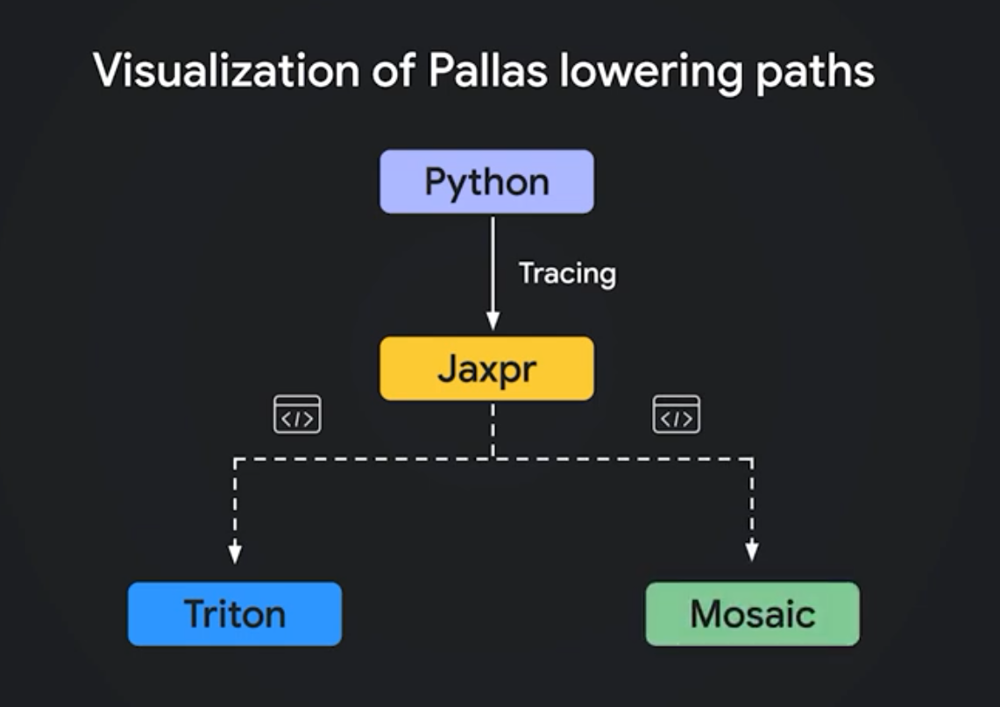
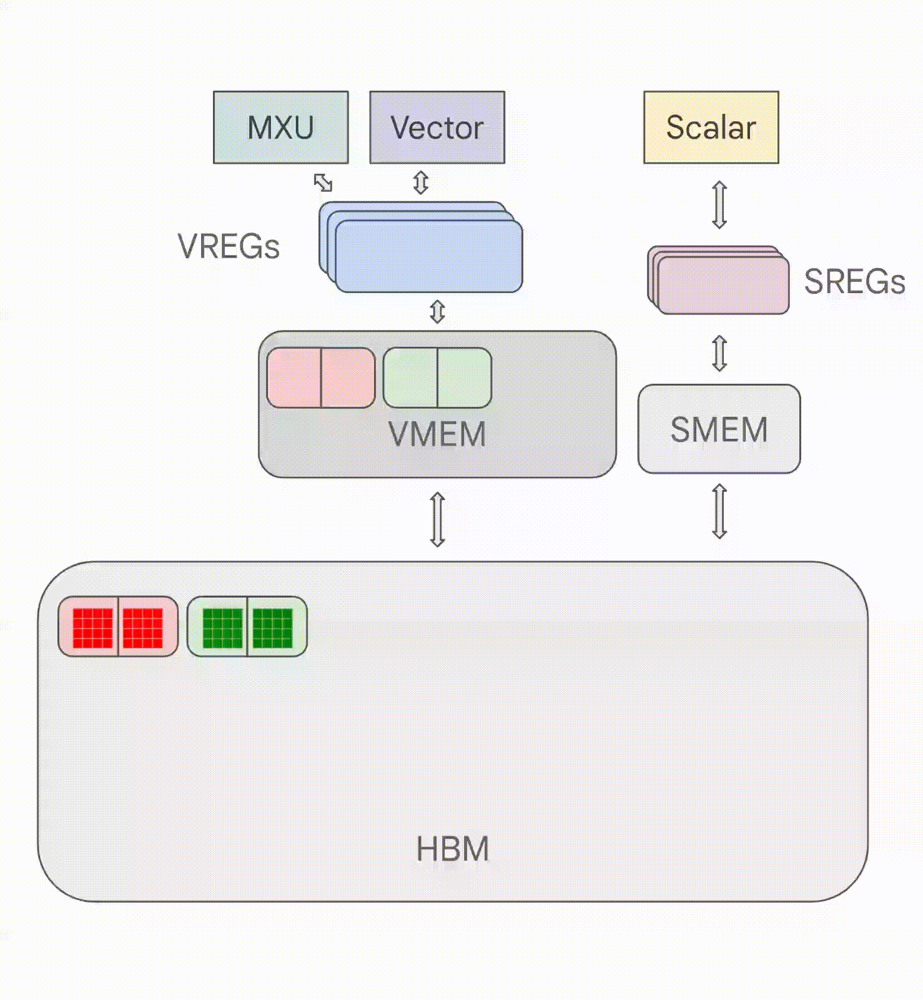
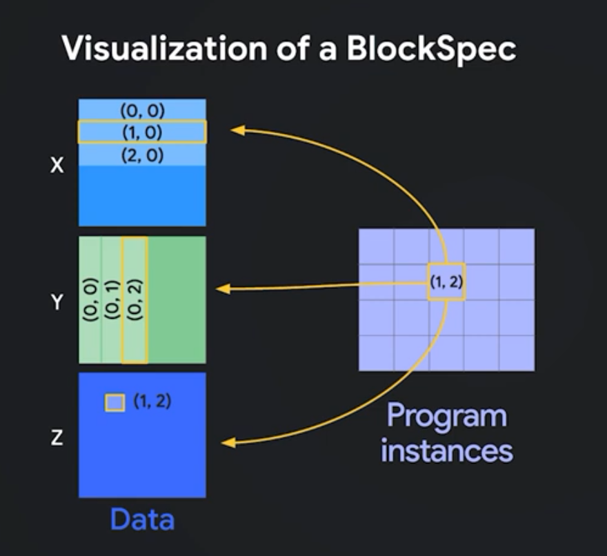

# Unlocking Kernel-Level Optimizations on TPUs using Pallas: A Getting Started Guide

> **Author:** [Bharath Rathinam](https://github.com/engineerbharath12) · **Published:** Thu, 28 May 2026 12:23:51 GMT  
> **Track:** TPU Supercomputing & Systems Architecture

---

In recent years, the intersection of artificial intelligence and high-performance computing has been dominated by a singular demand: massive, parallel hardware acceleration. As models scale from millions to billions of parameters, and as scientific simulations demand ever-increasing fidelity, achieving peak performance on accelerators like GPUs and Google’s Tensor Processing Units (TPUs) has become the defining engineering challenge.

To write software for these accelerators, the community relies on high-performance frameworks that translate complex mathematical operations into optimized machine code. In the **JAX** ecosystem, this translation is handled by a backend compiler called **XLA**(Accelerated Linear Algebra). JAX provides a clean, Pythonic API with automatic differentiation, while XLA works behind the scenes to fuse operations and map them to the specific hardware.

For the vast majority of tasks, this abstraction is flawless. You write Python, the compiler optimizes it, and the hardware hums. But what happens when the compiler’s heuristics aren’t enough? What happens when you need to squeeze every last drop of performance out of a multi-million-dollar TPU cluster?

That is where we must peel back the abstraction layer.

### 1. The Limits of Compiler Magic

The @jax.jit decorator is often treated as a magic wand. For standard software engineering tasks—adding vectors, scaling matrices, or simple linear layers—XLA (the compiler powering JAX) is a master of "Horizontal Fusion." It identifies adjacent mathematical operations and merges them into a single hardware pulse. If your workload is generic and linear, XLA is near-perfect, and you should likely stay there.

However, as you move toward production-grade systems — whether it’s complex **Attention mechanisms** in LLMs or high-frequency iterative physics — you inevitably hit an invisible wall. You add more compute units, but the performance flatlines. This is the **HBM Memory Wall**.

To understand why, imagine your accelerator (TPU or GPU) is a large-scale **Kitchen**. Your data consists of the **Ingredients**.

* **XLA** is like a generic kitchen manager. It’s great at organizing simple tasks, but it has one major flaw: It uses the tabletop, but it refuses to leave ingredients there. After every step in a complex loop, XLA insists on clearing the tabletop and sending the ingredients all the way back to the Warehouse (HBM) for safekeeping..
* If your **Recipe** requires you to stir, season, and taste the ingredients 100 times in a row, the time spent walking to the warehouse and back becomes 90% of your day. The stove (TensorCore) stays cold while the cook is walking.

Why is this a problem? Consider an **Attention Mechanism** in a Large Language Model. You cannot simply multiply a token once and send it back to the warehouse. A single token must be multiplied by Queries, Keys, and Values, scaled, exponentiated, summed, and normalized — a sequence of tightly dependent operations. If the manager forces the cook to walk to the warehouse between every single one of these steps, the walking time becomes 90% of your day. The stove (TensorCore) stays cold while the cook is walking.

#### Enter Pallas: The Escape Hatch

This is where **Pallas** comes in. Pallas is a Python-based, hardware-native extension for JAX that allows you to write your own custom kernels. It isn’t just for TPUs; it is a cross-platform tool that **automatically handles the complex “lowering” **of your code — using **Mosaic** for TPUs and **Triton** for GPUs.


*Pallas Lowering Path*

Because it is purely Python-based, you don’t need to be a C++ or CUDA expert to use it. If you know exactly how your operations should interact, Pallas allows you to take total control of the kitchen, keeping the ingredients “hot” in the **Cook’s Hands** (Registers) for as long as the recipe requires.

In a world of 6,000-chip clusters, saving a few milliseconds per operation by staying on the silicon isn’t just “cleaner code” — it’s a massive reduction in infra costs, potentially saving **millions of dollars**.

#### What We Will Cover

In this guide, we aren’t just going to look at syntax. We are going to:

* **Deconstruct the Hardware:** Understand the MXU, VPU, and VMEM staging areas.
* **Compare Orchestration:** See the difference between the CUDA “Thread” model and the Pallas “Grid” model.
* **Build a ‘Hello World’ Benchmark:** Create a 100-step iterative kernel and measure its performance against the XLA default.
* **Quantify the Victory:** Use real Trillium (v6e) metrics to show how we achieved an **11x speedup** by simply “staying on the tabletop.”

While JAX and XLA work seamlessly across both GPUs and TPUs, today we will focus specifically on unlocking kernel-level optimizations for TPUs using Pallas.

### 2. The Anatomy of an Accelerator

To write a “Silicon-Fluent” kernel, you must understand the physical hierarchy of the hardware. Think of a TPU (or GPU) not as a standard processor, but as a specialized kitchen designed for massive, parallel throughput.

* **HBM (High Bandwidth Memory) — The Warehouse:** This is your global storage (e.g., 32GB). It is massive but distant. Accessing HBM is like a cook walking across the street to a **Warehouse**; it takes a significant amount of time (latency). In standard XLA, every time a mathematical step finishes, the **Ingredients** (data) are often sent all the way back to this warehouse for safekeeping.
* **DMA (Direct Memory Access) — The Conveyor Belt:** The specialized controller that moves “Pallets” of data between the HBM warehouse and the factory floor. It is most efficient when moving large, contiguous blocks.
* **VMEM (Virtual Memory / SRAM) — The Fast Tabletop:** A tiny (typically 128MB), ultra-fast staging area located directly inside the compute core. This is your **Tabletop**. Before any math can happen, the DMA must place data here.
* **MXU (Matrix Multiply Unit) — The Heavy Press:** The matrix processor of the chip. A physical grid of transistors (e.g., 256x256 on TPU v6e) designed to perform matrix-matrix multiplications in a single “pulse.” It is the most powerful unit but requires data to be perfectly aligned to its width.
* **VPU (Vector Processing Unit) — The Precision Tool:** The vector processor. This unit handles non-linear math: sin, exp, log, and reciprocal divisions. While the MXU handles the bulk matrix weight, the VPU handles the complex vector science.
* **Registers — The Cook’s Hands:** The final destination. Data must be in the **Registers** to be manipulated. If you can keep data in the registers between Step 1 and Step 100, the speed of your program is limited only by the clock speed of the chip, not the speed of the memory wires.


*Data Movement with a TPU*

#### The Inefficiency of the Default Path

Consider a standard compute sequence: x = sin(dot(x, W)). In a default XLA execution(simplified example):

* **Step 1:** The MXU performs the dot matrix multiplication.
* **Warehouse Flush:** XLA often writes this result back to the **HBM Warehouse** to prepare for the next operation.
* **Step 2:** The VPU immediately needs that result for the sin calculation. The **Conveyor Belt (DMA)** must drive back to HBM, grab the data, and put it back on the **Tabletop (VMEM)**.

This “Walking Penalty” is the difference between a process that takes 10 seconds and one that takes 1. In a world where 6,000 chips work together on a single job, saving these few milliseconds per operation can save **millions of dollars** in compute energy and time.

### 3. Bridging the Gap: CUDA vs. Pallas

For engineers transitioning from the NVIDIA ecosystem, moving to Pallas requires a shift in how you think about “Parallelism.” In **CUDA**, you manage a hierarchy of **Threads and Blocks**, and you are largely responsible for writing the pointer arithmetic to move data from global memory into __shared__ memory.

In **Pallas**, the terminology changes to reflect a “Software-Defined” architecture where the compiler (Mosaic for TPU, Triton for GPU) handles the lowest-level hardware mapping:

* **CUDA “Grid” -> Pallas “Grid”:** In both worlds, the Grid is the “Work Schedule.” It is the total number of independent tasks you want to launch across the cluster.
* **CUDA “Shared Memory” -> Pallas “VMEM”:** This is the fast local staging area (the Tabletop).
* **CUDA “Thread Indexing” -> Pallas “BlockSpec”:** This is the biggest architectural departure. In CUDA, each thread calculates its own memory address using math inside the kernel (e.g., blockIdx.x * blockDim.x). In Pallas, you don’t write pointer math. Instead, you provide a **BlockSpec**—a declarative mapping passed to the orchestrator that tells the hardware: *"For Worker #i, grab this specific slice of the global tensor."*

**The Key Difference:** Pallas moves the “Addressing” logic out of the kernel’s math loop and into the **Orchestration layer**. This allows the DMA Forklift to know exactly where it’s going *before* the Cook even starts cooking, enabling perfect memory prefetching.

#### The Building Blocks of a Pallas Kernel

Before we write code, we must define three “Instructions” for the hardware:

* **The Grid (The Schedule):** You cannot process 1 Billion items at once. If your data has 1M items and your worker can process 2048 at a time, your **Grid** is roughly 500. It is simply the count of parallel workers you are hiring.
* **The BlockSpec (The Shipping Instruction):** This is the “Contract” between the HBM Warehouse and the VMEM Tabletop. It defines:

* **The Bucket Size:** Exactly how many rows and columns one worker carries (e.g., 2048 rows by 256 lanes).
* **The Address (The Lambda):** A small Python lambda function that tells each worker which shelf in the warehouse to visit based on their Grid ID.

**VMEM Limits (The Table Size):** The physical tabletop is fixed (128MB for Trillium and could be different for other generations). You must ensure your **Input Pallet + Output Pallet + Stationary Matrices** stay under this limit. A common rule of thumb on TPUs is to aim for a **96MB “Scoped Limit”** (controlled by XLA flag) to leave room for the compiler’s internal temporary variables.


*BlockSpec Visualization*

### 4. The “Hello World” Comparison

To make the benefit of Pallas undeniable, let’s look at a scenario that mimics the hardware stresses of an **LLM Attention Mechanism**. Our operation combines **Matrix operations (MXU)** and **Vector math (VPU)** in a tight loop:

**x = jnp.dot(x, w)**

* *Attention Equivalent:* Q * K^T = S
* *Hardware Action:* **MXU:** Bulk Matrix Multiplication.

**x = x * x + 0.1 * x**

* *Attention Equivalent:* exp(S)
* *Hardware Action:* **VPU:** Non-linear scaling.

**rho = jnp.mean(x)**

* *Attention Equivalent:* Sum(exp(S))
* *Hardware Action:* **VPU:** Cross-lane reduction (Summing the probabilities).

**x = x / rho**

* *Attention Equivalent:* P = exp(S) / Sum(exp(S))
* *Hardware Action:* **VPU:** Final Normalization (Softmax).

In standard JAX, you would use a loop. While XLA is an excellent compiler, it is designed to be “Safe.” Between each of these 100 steps, it typically writes the vector back to the **HBM Warehouse** to ensure intermediate results are preserved. This results in **100 round-trips** across the slow memory wires.

```
# CODE BLOB 1: THE XLA BASELINE (Standard JAX)
def step_logic(x, w):
    # 1. MXU: Matrix Multiplication
    x = jnp.dot(x, w)
    # 2. VPU: Non-linear Activation and Normalization
    x = x * x + 0.1 * x
    rho = jnp.mean(x, axis=-1, keepdims=True)
    x = x / (rho + 1e-6)
    return x
```

```
@jax.jit
def run_xla(data, weights, steps):
    def body(carry, _):
        # Every step here triggers an HBM write/read cycle
        return step_logic(carry, weights), None
```

```
    res, _ = jax.lax.scan(body, data, None, length=steps)
    return res
```

#### The Silicon-Fluent Path (Pallas)

In Pallas, we break the “Memory Wall” (which is exactly what **FlashAttention** does). We pull the data into the **Registers** once, perform all 100 mathematical transformations entirely on the compute units, and only save the final result to the HBM warehouse at the very end.

```
# CODE BLOB 2: THE PALLAS SILO (The Recipe)
def pallas_kernel(x_ref, w_ref, out_ref, *, steps):
    # 1. LOAD: HBM -> Registers (ONE TRIP)
    x = x_ref[...]
    w = w_ref[...]
```

```
    # 2. THE SILICON SILO: 100 steps purely in Registers
    for _ in range(steps):
        # MXU
        x = jnp.dot(x, w)
        # VPU
        x = x * x + 0.1 * x
        rho = jnp.mean(x, axis=-1, keepdims=True)
        x = x / (rho + 1e-6)
```

```
    # 3. STORE: Registers -> HBM (ONE TRIP)
    out_ref[...] = x
```

#### The Orchestration: Why do we need it?

To achieve peak performance, TPUs give you direct control over memory rather than managing it automatically. This means you must provide explicit instructions on how data should be divided and moved through the chip.

* **grid**: Tells the TPU how many independent parallel workers to hire.
* **BlockSpec**: The address "GPS." It tells the hardware the exact size of the data chunk (e.g., 2048x256) and uses a lambda to calculate where in HBM to find it.
* **in_specs & ****out_specs**: Mandatory instructions for the DMA Forklift. They define exactly how to move the data onto the fast VMEM tabletop before the kernel starts, and how to pack it back into HBM when it finishes.

In an Attention mechanism, you control your sequence length by tuning BLOCK_M (e.g., 2048) in the BlockSpec. You slice the massive sequence into smaller blocks that perfectly fit the 128MB VMEM, maximizing the block size to hide DMA latency.

```
# CODE BLOB 3: THE PALLAS MANAGER (The Orchestration)
def run_pallas(data, weights, steps):
    # Grid: Chop 1M rows into stacks of 2048
    grid = (data.shape[0] // 2048,)
```

```
    return pl.pallas_call(
        functools.partial(pallas_kernel, steps=steps),
        out_shape=jax.ShapeDtypeStruct(data.shape, data.dtype),
        grid=grid,  # Schedule the workers
        in_specs=[
            # BlockSpec: Instructions for moving 2048-wide stacks
            # Buffered(2) creates the double-buffering conveyor belt
            pl.BlockSpec((2048, 256), lambda i: (i, 0), pipeline_mode=pl.Buffered(2)),
            # Weights: Marked as VMEM stationary so all workers share them
            pl.BlockSpec((256, 256), lambda i: (0, 0), memory_space=pltpu.MemorySpace.VMEM),
        ],
        out_specs=pl.BlockSpec((2048, 256), lambda i: (i, 0), pipeline_mode=pl.Buffered(2)),
        compiler_params=pltpu.CompilerParams(dimension_semantics=("parallel",))
    )(data, weights)
```

### 5. The Evidence — Benchmark Results

To prove this hardware-native philosophy, we ran this “Hello World” comparison on a **TPU v6e (Trillium)** using a scale of 1 Million vectors (width 256). We measured both the wall-clock time and the internal hardware utilization.

The XLA Baseline (100 Iterative Steps)
** Time: 180.00 ms**
 * **TensorCore Utilization: 9.78%**
 * Diagnosis: The chip was effectively “starving.” It finished the MXU and VPU math in microseconds but sat idle 90% of the time, waiting for the memory forklift to travel all the way to HBM and back for every single iteration.

The Pallas Silo (100 Iterative Steps)
 *** Time: 15.21 ms**
** * TensorCore Utilization: 54.00%**
 * SPEEDUP: 11.83x

* *Diagnosis:* By staying locked on the silicon, we increased the active compute time of the transistors by 5.5x. The 54% utilization is an elite figure for a mixed MXU/VPU workload, indicating a near-perfect overlap between computation and memory fetching.

### Conclusion: The Business Impact

Writing a Pallas kernel is not just an exercise in “cleaner code” or advanced engineering. It is a response to **business reality.**

When you are running a foundation model or a massive scientific simulation at scale — whether it’s on a 4-chip pod or a 6,000-chip cluster — saving **165 milliseconds** per block isn’t a minor tweak. Over billions of inference tokens or weeks of distributed training, those milliseconds consolidate into **millions of dollars** in saved energy, reduced latency, and reclaimed compute costs.

**Standing on the Shoulders of the Community: Tokamax** You don’t always have to write these kernels from scratch. The open-source community has already built highly optimized Pallas implementations for the most complex operations (like FlashAttention and MoE Routing) for both TPUs and GPUs. If you are looking to integrate these optimizations into your workflow, you should explore [**Tokamax**](https://github.com/openxla/tokamax). Tokamax is a curated library of State-of-the-Art (SOTA) custom accelerator kernels built on top of JAX. It not only provides pre-built, silicon-fluent kernels, but also includes automated autotuning tools to help you find the absolute perfect BLOCK_M size for your specific hardware architecture. Furthermore, it provides a dedicated tokamax.benchmark() utility that strips away Python overhead, allowing you to measure the true, raw hardware throughput of your kernels.

However, relying solely on pre-built libraries is not a silver bullet. As AI research accelerates and model architectures rapidly evolve — introducing novel mechanisms like speculative decoding trees or custom structured sparsity — you will inevitably encounter bottlenecks that no community library has solved yet. When that day comes, knowing how to write your own Pallas kernel is the ultimate superpower. Learning Pallas is the best place to start your journey into hardware-native optimization.

**Rules of Thumb for Pallas:**

* **Width is Rigid:** Always align your data to the MXU hardware width (e.g., 256).
* **Height is Flexible:** Tune your BLOCK_M (e.g., 2048) to be large enough to hide DMA latency but small enough to stay under the 96MB VMEM limit.
* **Stay in the Silo:** Fuse as many sequential operations as possible into the kernel loop. The fewer trips to HBM, the greater your victory over the Memory Wall.

Pallas allows you to stop fighting the compiler and start speaking the hardware’s native language. It transforms the accelerator from a generic memory-shuffler into a dedicated, high-velocity compute engine.

---

### Links & References
* **Part of:** [Bharath's AI Infrastructure Playbook (BRs-AI-Infra-Playbook)](../../README.md)
