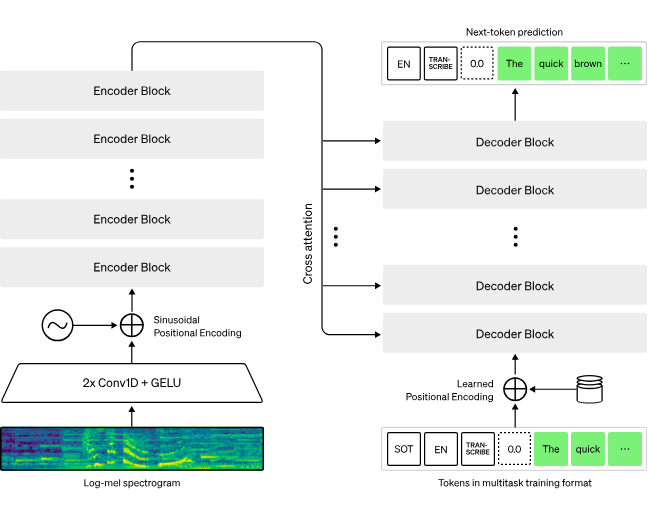
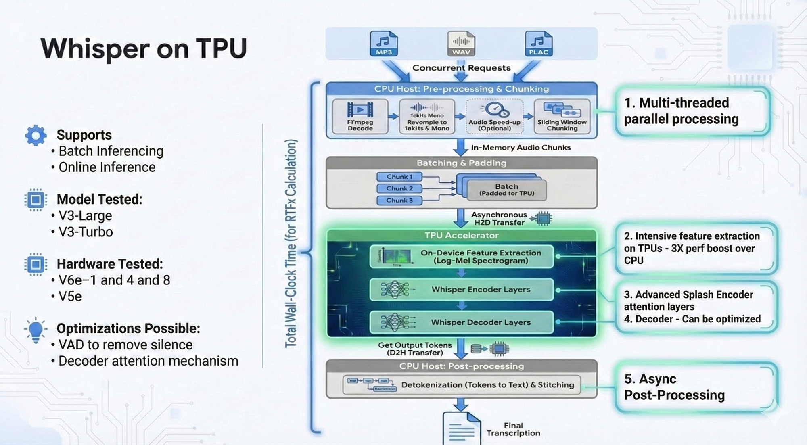

# Unlocking Supersonic Speech Recognition: A Deep Dive into Optimizing Whisper on TPUs

> **Author:** [Bharath Rathinam](https://github.com/engineerbharath12) · **Published:** Wed, 10 Dec 2025 13:14:16 GMT  
> **Track:** TPU Supercomputing & Systems Architecture

---

**A Technical Report on JAX-based High-Throughput ASR Inference**

[Link to the Whisper on TPU Repository](https://github.com/engineerbharath12/whisper-tpu-google)

### 1: Introduction

In the rapidly evolving landscape of Artificial Intelligence, **speech** has become the new user interface. Automatic Speech Recognition (ASR) is the technology that converts spoken words into text. At the heart of this revolution sits OpenAI’s **Whisper**, a model that has set the gold standard for high-accuracy multilingual ASR. Whisper follows a classic **Encoder-Decoder** architecture:

* **Feature Extraction:** Raw audio is first converted into a visual representation — the **Log-Mel Spectrogram** — which represents the energy of frequencies over time. This step is necessary as the model’s Encoder cannot process raw waveform directly.
* **The Encoder:** Reads the spectrogram and produces a dense, high-level understanding of what was said.
* **The Decoder:** Acts autoregressively, consuming the Encoder’s output to generate the final transcription token by token (word piece by word piece).


*Whisper Model: Architecture*

We worked with two primary model configurations:

* **Whisper-v3-large:** The most robust model, offering unmatched accuracy for both transcription and translation tasks. This model has a large number of decoder layers.
* **Whisper-v3-large-turbo:** A speed-optimized variant that drastically reduces the number of decoder layers (from 32 to 4). While accelerating raw transcription speed, this reduction makes it unsuitable for complex translation tasks where the full **v3-large** model scores higher.

The efficiency of any ASR pipeline is measured by two key metrics:

* **RTFx (Real-Time Factor):** Similar to throughput, this metric quantifies how many times faster than real-time the audio can be transcribed or translated. Processing hours of audio in seconds is the goal.
* **Latency:** Critical for online/streaming inference, this measures how quickly the first tokens of the transcription are generated and returned to the user.

This report details the implementation of Whisper models on Google Cloud TPUs using the JAX framework. We explore various optimizations, including implementing advanced attention mechanisms via Pallas kernels, and enhancing the pre- and post-processing pipelines. Most importantly, we showcase how efficiency was unlocked by moving the crucial feature extraction step (raw audio to Mel-spectrograms) onto the TPU and utilizing custom **Splash Attention** mechanisms within the Encoder.

### 2: The JAX Advantage

When building high-performance AI systems, especially for Google’s Tensor Processing Units (TPUs), **JAX** is the weapon of choice. It serves as a high-performance numerical computing library, offering three core powers:

* **Automatic Differentiation:** JAX can automatically and efficiently differentiate native Python and NumPy code, which is foundational for modern machine learning.
* **Functional Programming:** Its immutable array design and functional primitives make it simpler to write bug-free, composable code for distributed systems.
* **XLA Compilation:** JAX uses the **Accelerated Linear Algebra (XLA)** compiler to trace the entire Python program and compile it into a single, highly optimized graph. This graph runs directly on the TPU hardware, enabling operations to be fused together and minimizing expensive data transfers between memory and compute units. This capability provides the flexibility of Python with the raw performance of C++.

### 3: The Power of TPUs

Google’s Tensor Processing Units (TPUs) are not general-purpose hardware; they are domain-specific architectures built from the ground up to accelerate matrix multiplication — the fundamental operation in all modern Transformer models like Whisper. Our implementation leverages the latest generations of Cloud TPUs (v5e, v6e) , which excel at handling massive, parallel workloads.

Unlike a CPU that handles tasks sequentially, a TPU using its systolic arrays is designed like a vast assembly line, processing thousands of data points simultaneously. This massive parallelism is what makes the latest and greatest large models from Google possible, and by porting Whisper to this architecture, we tapped into an unrivaled performance ceiling.

### 4: Whisper-on-TPUs — Optimizations for Supersonic Speed

The open-source Whisper-on-TPU repository is a re-imagining of the model’s inference pipeline with advanced attention mechanisms. We support both **Online** (streaming) and **Offline** (batch) inference and have optimized performance for both **whisper-v3-large** and **turbo** models.

### 4.1 High-Level Flow and Software Engineering

The secret to a high-performance pipeline is balancing the load effectively between the Host (CPU) and the Device (TPU). The workflow is structured as follows:

**Workflow:**

* **CPU (Pre-processing):** Acts as the conductor, handling I/O and orchestration: decoding raw audio files (mp3, wav), chunking them into fixed segments, and managing the input queue.
* **TPU (Feature Extraction & Inference):** Handles the heavy computation: Feature extraction (creating Mel-spectrograms), Encoding (understanding the audio), and Decoding (generating tokens).
* **CPU (Post-processing):** Detokenization on CPUs: Converts the TPU’s raw token IDs back into human-readable text.


*Whisper Implementation on TPU*

**Software Engineering for Efficiency:**

Beyond raw accelerator power, high-quality software engineering for the entire inference pipeline is a critical factor for maximal throughput. Efficiently engineering the pre-processing steps is essential to ensure that the Tensor Processing Unit — the high-value accelerator — is never starved of input data. This continuous data flow ensures the entire machinery operates at peak utilization, producing maximum output.

TPUs prefer working with “static shapes,” meaning they are most efficient when processing the exact same tensor dimensions every time. However, real-world audio requests come in varying lengths. To solve this without constant, costly recompilation, we introduced **Bucket Batching**. Incoming audio requests are grouped and padded to fit predefined “buckets” (e.g., batch sizes of 4, 40, 80). This technique handles various concurrencies and audio file lengths efficiently, preventing the TPU from constantly “shifting gears” and maximizing utilization.

### 4.2 Feature Extraction: The TPU Advantage

Traditionally, feature extraction (converting audio samples to Mel-spectrogram representations) is performed on the CPU using Transformers libraries. In high concurrency scenarios, especially with large audio files, the CPU can become throttled and limit the overall pipeline speed. **We moved the Log-Mel Spectrogram calculation directly to the TPU.**

This optimization yielded significant operational advantages:

* **Performance Boost:** We observed a **3x performance enhancement** on the feature extraction step alone compared to CPU-based execution, leading to a **10–15% improvement** in the overall RTFx of the pipeline, especially for massive concurrency of short audio files. For high load (100 concurrent 5-minute files), the TPU consistently outperformed the CPU by a factor of 2.5x to 3.0x in pure compute time.
* **Reduced CPU Bottleneck:** The TPU’s massive parallelism processes the Short-Time Fourier Transform (STFT) and Mel filterbank operations virtually instantly as part of the fused XLA graph, efficiently handling parallel loads that would otherwise bottleneck the CPU.
* **Enhanced Stability:** Crucially, moving this step allowed us to implement a mathematically aligned feature extraction fix (see Section 3.3), which enhanced the accuracy and stability of transcriptions, even when speeding up the audio input from 1x to 3x speed.Enhanced Stability: Crucially, moving this step allowed us to implement a mathematically aligned feature extraction fix (see Section 3.3), which enhanced the accuracy and stability of transcriptions, even when speeding up the audio input from 1x to 3x speed.

However, moving the feature extraction to the TPU (as opposed to having it on the CPU and pushing the Mel-spectrogram representations to the TPU) increases the volume of raw audio data transferred to the TPU. Therefore, this implementation would make a huge impact for highly concurrent and bulk audio pipelines.

### 4.3 Deep Dive: TPU Feature Extraction Fix & Stability Analysis (“The 2x Speed Crash”)

To further improve the efficiency of the pipeline we also incorporated speeding up the audio processing speed from 1x to 2x and 3x while the audio was proceeded in memory using the ffpmeg but it impacted the audio transcription quality. On further troubleshooting we narrowed down on the initial TPU feature extraction implementation. Our most challenging bug occurred during performance testing: when speeding up audio input to 2x (**using ffmpeg atempo=2.0**) for Whisper Large V3, the transcription devolved into an infinite loop of gibberish (e.g., *“femandroandroandro…”*).

**Root Cause: V2 vs. V3 Standards Mismatch**

The issue was isolated to our custom TPU Feature Extractor, which was based on older Whisper V2 standards. Whisper V3 introduced subtle but critical changes to the spectrogram generation process, leading to a mismatch between the features the model was trained on and the features our JAX implementation was generating.

**Deviation A: The Mel Filters**

* **Legacy JAX Code:** Used HTK-style Mel filters. The mathematical representation
* **Whisper V3 Standard (Slaney-style):** Uses Slaney filters (Librosa default), which normalize the area of each triangular filter, changing the relative amplitude of frequency bands.

**Deviation B: Normalization**

* **Legacy JAX Code:** Used **Instance Normalization** (forcing audio to have zero mean and unit variance), which destroys absolute volume information. The mathematical representation:
* **Whisper V3 Standard (Clamping):** Uses **Log-Magnitude Clamping** (clipping silence below -80dB), which preserves the dynamic range between loud and quiet segments.

**The Fix: Mathematical Alignment in JAX**

We completely rewrote the JAX Feature Extractor to strictly match the V3 specification, ensuring the model received input within its expected distribution.

**1. Filters: Porting Librosa Logic**

We replaced the manual HTK math with a direct call to librosa during compilation to generate the exact Slaney filterbank matrix used by the CPU processor.

**Code Implementation:**

```
# OLD (HTK)def hz_to_mel(freq): return 2595.0 * jnp.log10(1.0 + freq / 700.0)
# NEW (Slaney)import librosamels = librosa.filters.mel(sr=16000, n_fft=400, n_mels=128, norm='slaney')
```

**2. Normalization: Implementing Clamping**

We removed the Mean/Variance logic and implemented the V3 Clamping logic in JAX:

**Code Implementation:**

```
# OLD (Instance Norm)spec = (spec - jnp.mean(spec)) / jnp.sqrt(jnp.var(spec) + 1e-7)
# NEW (Clamping)log_spec = jnp.log10(jnp.maximum(spec, 1e-10))max_val = jnp.max(log_spec)log_spec = jnp.maximum(log_spec, max_val - 8.0) # Clamp to top 80dBlog_spec = (log_spec + 4.0) / 4.0 # Scale to [-1, 1]
```

**Operational Impact**

* **Stability:** The hallucinations vanished, and the V3 Large and Turbo models now work perfectly at 2x/3x speed.
* **Speed:** This fix unlocked the ability to use the fast TPU extractor for the **Turbo** model, propelling its performance to a staggering **~2200RTFx **per chip.

### 4.4 Splash Attention: Turbocharging the Encoder

Attention mechanisms, which allow the Encoder to understand relationships within the audio features, are computationally expensive (quadratic complexity). To maximize efficiency on the TPU, we integrated **Splash Attention** (a TPU-optimized variant of Flash Attention).

**What is Splash Attention?**

It is a custom [Pallas kernel optimizatio](https://docs.jax.dev/en/latest/pallas/index.html)n that reorders attention computation to optimize how the chip reads and writes to memory. Instead of processing the entire large attention matrix at once, it breaks it into blocks. This reduces the amount of memory movement, dramatically increasing the speed of the most critical part of the model.

**The Impact:**

* This optimization delivered a **30% speedup** in the encoder layer specifically, resulting in a **5–10% boost** to the overall pipeline RTFx.

### 4.5 Async Post-Processing

The final phase of the pipeline — converting the token IDs generated by the TPU back into human-readable text (detokenization) — is inherently CPU-bound. To prevent the fast TPU from sitting idle, we adopted a “fire and forget” strategy using an asynchronous pipeline.

As soon as the TPU completes its inference and generates the token IDs, it pushes them to a queue and immediately pulls the next batch of audio for processing. A separate, dedicated pool of CPU threads asynchronously picks up these token IDs, performs necessary operations (like removing special tokens such as <|startoftranscript|>), and formats the final text output. This concurrency ensures the high-value TPU is never waiting on the slower CPU processes.

### 4.6 Other Optimizations

We utilized other configuration-based optimizations within the decode stage to further reduce latency and improve quality:

* **Skip Special Tokens:** Setting **skip\_special\_tokens=true** simplifies the detokenization process, reducing the post-processing overhead by automatically omitting metadata tokens.
* **Max Number of Tokens:** By setting a finite **Max\_num\_of\_Tokens**, we prevent the model from entering an infinite loop of hallucination (a common failure mode) and guarantee a latency ceiling for the request.
* **Configurable Behavior:** The repository uses a config.yml file to configure these and other behaviors, allowing users to integrate and control pipeline behavior without modifying core code.

### 5: Future Frontiers & Lessons Learned

Optimization is a continuous process. Here is what we explored and where we plan to focus next.

### VAD as a Pre-processing Step

**VAD (Voice Activity Detection)** models (like Silero) identify and cut out periods of silence from an audio file. We hypothesized that feeding the Whisper pipeline only segments containing speech would save computation time. However, our experiments showed a paradoxical result:

* **The Verdict:** The computational overhead of running the VAD model on the CPU outweighed the time saved by the TPU. The Whisper model is already efficient at ignoring silence, and the pre-processing step added a performance “tax” that made the entire process slower. This area requires further exploration to find a way to implement VAD without incurring excessive CPU overhead.

### Decoder Attention Mechanisms Optimizations

The Encoder is currently blazing fast (thanks to Splash Attention). The new bottleneck has shifted to the Decoder layer. Due to the **autoregressive nature** of the Decoder, which generates text one word at a time, most of the inference time is now spent here, making it a memory-bound operation.

* **The Plan:** We are currently investigating implementing custom Pallas kernels or integrating advanced techniques like **Ragged Paged Attention** to enhance the Decoder’s efficiency. This optimization is crucial for the deep **v3-large** model (32 layers), where latency is dominated by this step, but less critical for the **v3-large-turbo** model (4 layers).

### 6: Conclusion

The Whisper-on-TPU project is the culmination of months of intense engineering efforts aimed at fully utilizing the power of TPU hardware accelerations. By moving the entire pipeline — from complex signal processing logic to inference — onto JAX and TPUs, and by solving deep mathematical discrepancies in feature extraction, we’ve built a system capable of transcription at supersonic speeds.

[Link to the Whisper on TPU Repository](https://github.com/engineerbharath12/whisper-tpu-google)

---

### Links & References
* **Part of:** [Bharath's AI Infrastructure Playbook (BRs-AI-Infra-Playbook)](../../README.md)
